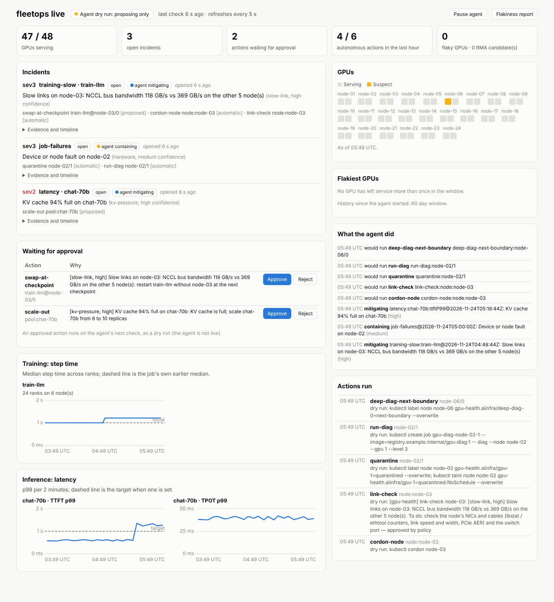

# Live agent and dashboard

`fleetops serve --agent` watches training and inference as data streams in. Every 30 seconds it finds what is going
wrong, diagnoses it, and mitigates it within the limits you would set for a person on call. It then checks whether
the mitigation worked and pages someone when it didn't. The same process serves a live dashboard at `/live`. The page
shows GPU states and flakiness, open incidents, everything the agent did, and approve and reject buttons for what it
proposed.

```bash
fleetops serve --agent --tokens tokens.jsonl --targets targets.json      # dry run: proposes, runs nothing
fleetops token create --tokens tokens.jsonl --name ana --roles read,approve   # one token per approver
# open http://<host>:9400/live
```

Try it without a fleet:

```bash
fleetops demo --scenario slow-link --now --store demo     # a training job slowed by one node's network, ending now
fleetops serve --agent --store demo                       # http://127.0.0.1:9400/live
```



## What each check does

| Step | What happens |
|---|---|
| Devices | gpu-health's analysis of the last 6 hours of device records: GPU states, faults, risk, and the flakiness history. |
| Incidents | Detection over the last hour: job failures, serving latency (TTFT, TPOT; against `--targets` too), training slowdowns and hangs. |
| Diagnose | Root-cause analysis of each incident (the 14 rules in [RCA.md](RCA.md)). Each hypothesis carries `targets`: the node, GPU, replica, change or switch to act on. |
| Decide | The top cause's playbook gives actions. The confidence of the diagnosis and the guardrails below decide how far the agent may go. |
| Act | One merge into gpu-health's action queue, then the approved actions run. Commands run only with two locks open: `--live` on the agent and `"policy": {"dryRun": false}` in the gpu-health config. |
| Verify | `verifyAfterS` (10 min) after acting, it judges the data since the action against the incident's own baseline. Cleared: the incident is marked mitigated. Still there, or no data to tell: a person is paged. |

## The playbook

| Cause | Training | Inference | Elsewhere |
|---|---|---|---|
| `hardware` | quarantine the GPU, run a diag, swap the node out at the next checkpoint | drain the replica on it | cordon nodes with failures but no GPU named |
| `straggler` | reset locked clocks, deep diag at the next boundary, swap the node out at the next checkpoint | | |
| `slow-link` | cordon the node, ask for a NIC and cable check, swap it out at the next checkpoint | | |
| `collective-hang` | cordon the node of the rank that never joined; restart the job from its last checkpoint without it | | |
| `replica-tail` | | drain the slow replica (not the last one), diag its node | |
| `kv-pressure`, `load`, `slow-stage` (queue) | | scale the pool out by 25% (at most `maxScaleOutStep`) | |
| `change` | | | roll back a Helm revision (`namespace/release#rev` → `rev-1`); otherwise ask for the change to be held |
| `version-cohort` | | | hold the rollout; cordon the nodes on that version |
| `shared-component` | | | check the switch, rack or PDU; cordon the nodes behind it |
| `workload` | | | tell the owner; the GPUs are not the cause |
| `infrastructure` | | | page a person: storage, scheduler and network have no automatic fix here |
| `monitoring-gap` | | | check the exporters; take no device actions |

What each action runs is a gpu-health executor: an argv template, never a shell string. Every value filled into one is
checked against a safe pattern. Replace the defaults with your environment's commands in the gpu-health config.

| Action | Default command | Default mode |
|---|---|---|
| `cordon-node` / `uncordon-node` | `kubectl cordon NODE` / `kubectl uncordon NODE` | auto / approve |
| `drain-replica` | label the pod `gpu-health.aiinfra/serving=false` (the Service selects `true`) | approve |
| `scale-out` | `kubectl -n NS scale deployment POOL --replicas=N` | approve |
| `rollback-change` | `helm rollback RELEASE REV -n NS --wait` | approve |
| `restart-without-node` | label the node for the training launcher: restart from the last checkpoint without it | approve |
| `swap-at-checkpoint` | label the node for the launcher: swap it out at the next checkpoint | approve |
| `quarantine`, `run-diag`, `config-reset`, `deep-diag-next-boundary` | gpu-health's | auto |
| `link-check`, `hold-rollout`, `notify-owner`, `exporter-check` | a message to the gpu-health webhook | auto |

By default, the agent on its own only stops new work landing on a node, runs diagnostics and tells people. Anything
that moves running work, adds cost or undoes a change waits for a person. To act on inference in real time, use
[examples/agent-policy.realtime.json](../examples/agent-policy.realtime.json) as the gpu-health config. With it,
draining a slow replica and scaling a pool out by at most 2 replicas run on their own. Training work still never moves
without a person.

## Guardrails

- **Confidence decides how far it goes:**
  - high: the playbook as the policy allows;
  - medium: only containing actions (cordon, diag, messages) run on their own; the rest wait for a person;
  - low: nothing; the incident is opened and a person is paged.
- **The agent only lowers autonomy.** It can turn an `auto` action into `approve`, never the other way.
- **Monitoring gap freezes it.** When gpu-health's circuit breaker trips (over 20% of GPUs stop reporting) or the top
  cause is `monitoring-gap`, the agent takes no device actions.
- **Blast radius:**
  - it cordons at most `maxCordonShare` (10%) of the nodes on its own;
  - each run cordons at most `maxNodeCordonsPerRun` (2) and quarantines at most gpu-health's 10% limit;
  - over the limit, actions wait for a person.
- **An hourly limit:** `maxAutoActionsPerHour` (6) autonomous changes per hour across checks. Messages to people don't
  count; approved actions don't either.
- **Pause:** the dashboard's Pause button, `fleetops agent pause --by NAME`, or a `PAUSE` file in the state directory.
  While paused, the agent keeps watching and opening incidents but runs nothing, approved actions included.
- **Approvals are by a person:** approve and reject need a token with the `approve` role, and the approver recorded
  is the token's owner. Make one token per person.
- **Approved actions are still checked:** they run on the agent's next check, through the same two locks and blast
  radius limits. An action older than `maxActionAgeSec` isn't run; the next analysis proposes it again if it still
  applies.
- **Paging is a dry run unless `--live`,** like `incidents page`.
- **Everything is recorded:**
  - every decision goes to `<state>/agent.jsonl` and is added as a note on the incident;
  - every command run goes to gpu-health's `audit.jsonl`.

## Shadow mode first

Without `--live` the agent runs exactly as it would live: it opens incidents, applies the limits and verifies. It just
runs nothing, and the log says "would run". After the verification window it records whether each incident cleared
on its own. Run it next to on-call for a week or two. Compare its decisions with what people did, then go live one
action kind at a time:
1. switch that kind to `auto` in the policy;
2. set `policy.dryRun: false`;
3. add `--live`.

## Options

`fleetops agent` and `fleetops serve --agent` take the same options. `--agent-config FILE` takes them as JSON; see
[examples/agent.example.json](../examples/agent.example.json).

| Option | JSON | Default | |
|---|---|---|---|
| `--interval S` | `intervalS` | 30 | seconds between checks |
| `--window S` | `windowS` | 3600 | incidents are looked for in this window |
| `--targets FILE` | `targets` | none | latency targets per pool: `{ "chat": { "ttftP99": 1.0 } }` |
| `--min-failures N` | `minFailures` | 5 | job failures that make an incident |
| | `pools` | none | `{ "chat": { "namespace": "serving", "replicas": 8 } }` when requests don't name replicas |
| | `verifyAfterS` | 600 | |
| | `maxAutoActionsPerHour` | 6 | |
| | `maxCordonShare` | 0.1 | |
| `--page-to P --page-key K --page-url U` | `page` | none | PagerDuty, Opsgenie or a webhook, for incidents at `minSeverity` (sev2) or worse, the ones it can't act on, and failed mitigations |
| `--prom URL --loki URL` | | none | pull each check's window from Prometheus and Loki instead of (or as well as) remote_write |
| `--config FILE` | | gpu-health defaults | gpu-health config: modes, limits, executors, `dryRun` |
| `--state DIR` | | `<store>/agent` | action queue, audit, history, decisions |
| `--live` | | off | the agent's lock; the policy's `dryRun: false` is the other |

Other commands:
- `fleetops agent status`: what it's doing;
- `fleetops agent log`: its decisions;
- `fleetops agent approve ID --by NAME` / `reject ID --by NAME`;
- `fleetops agent --once`: one check, for cron or a test.

## Dashboard API

| | Role |
|---|---|
| `GET /live` | none: the page holds no data, and its calls carry the token |
| `GET /api/live` | read: everything the page shows |
| `GET /api/flakiness[?format=html]` | read: gpu-health's flakiness view of the agent's history |
| `POST /api/agent/actions/ID/approve`, `…/reject` (`{ "reason" }`) | approve |
| `POST /api/agent/pause`, `/api/agent/resume` | approve |

## Running it live

- **Commands run where fleetops runs.** In a container, add `kubectl` (and `helm` for rollbacks) to the image.
- **Permissions:** give the service account the RBAC those commands need: cordon nodes, label nodes and pods, scale
  deployments. gpu-health's `deploy/rbac.yaml` covers the node and pod labels.
- **The training side needs your launcher to watch the labels.** `swap-at-checkpoint` and `restart-without-node` work
  only if the launcher (an elastic agent, or an operator) reacts to them.

## What was checked

- **Tests:**
  - each playbook on the benchmark scenarios;
  - the confidence and blast-radius guardrails, and the hourly limit;
  - pause, and live runs through a fake runner;
  - approvals running on the next check;
  - verification that clears, persists or has no data, with paging;
  - the dashboard API's roles, with the approver taken from the token;
  - the realtime policy example.
- **The dashboard** was rendered in Chrome in light and dark mode, with an approval, a pause and the chart tooltips
  checked by clicking through.
- **Not checked:** commands against a real cluster. The default executors are the same `kubectl` and `helm` calls as
  gpu-health's, but they haven't been run against Kubernetes here.
