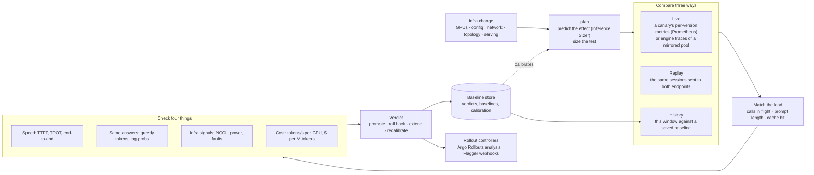

# Shadow upgrades

Measure an infra change before it ships, and keep measuring the baseline so drift is caught. The change can be new
GPUs, an engine version or its configuration, networking, topology, or the serving layout.

```
fleetops shadow plan    --baseline-config h100.json --candidate-config b200.json --trace sessions.jsonl --rps 4 --out plan.json
fleetops shadow replay  --trace sessions.jsonl --baseline http://vllm-old:8000 --candidate http://vllm-new:8000 --model M --live
fleetops shadow answers --baseline http://vllm-old:8000 --candidate http://vllm-new:8000 --model M --live --out answers.json
fleetops shadow compare --baseline variant=baseline,source=shadow-replay --candidate variant=candidate,source=shadow-replay \
                        --plan plan.json --answers answers.json --baseline-gpus 8 --baseline-rate 2.5 --candidate-gpus 8 --candidate-rate 5
fleetops shadow baseline save --name chat --select pool=chat --from 2026-11-01 --to 2026-11-08
fleetops shadow watch --name chat --select pool=chat --from 2026-11-24
fleetops shadow demo                                     # a candidate that looks faster and isn't

# from a canary's own metrics (vLLM in Prometheus), and as the judge inside Argo Rollouts and Flagger
fleetops shadow prom  --prom http://prometheus:9090 --select 'namespace="llm"' --baseline 'llm_isvc_name="chat-v1"' \
                      --candidate 'llm_isvc_name="chat-v2"' --lookback 3600 --baseline-lookback 21600
fleetops shadow serve --prom http://prometheus:9090 --host 0.0.0.0 --no-auth     # deploy/shadow-gate/ has the manifests
fleetops shadow prom --demo                              # a canary that looks 20% faster per version and is 8% slower
```

## Architecture



The same design is on the team whiteboard: *Shadow upgrades for AI infra*.

### Components

| Piece | Code | Reads | Writes |
| --- | --- | --- | --- |
| Plan | `shadow.mjs` `plan`, `predict`, `testSize` | two Inference Sizer configs `{ model, gpu, tp, gpus?, rate? }`; a workload (trace, profile, or request records) | `plan.json`: predicted effects, requests per arm |
| Replay | `shadow-replay.mjs` `requestsFrom`, `run` | a trace or an agentic profile (FleetScope); two OpenAI-compatible endpoints | `request` records with `variant` and `pair`, in the store |
| Same answers | `shadow-replay.mjs` `answers` | a prompt set (built-in or a file); the two endpoints | `answers.json` |
| Compare | `shadow.mjs` `compare`, `effect`, `judge` | request records for each arm (store selectors or a results file); plan, answers, infra | a verdict; one line in `<store>/shadow/verdicts.jsonl` |
| Infra signals | `shadow.mjs` `infraSignals` | the store's `collective`, `device` and `log` records for each arm's nodes | part of the verdict |
| Baselines and watch | `shadow.mjs` `makeBaseline`, `drift` | request records of a service | `<store>/shadow/baselines/NAME.jsonl` (each save a version), `watch-NAME.jsonl` |
| Canary metrics | `shadow-prom.mjs` `queries`, `fetchArms`, `compareWindows` | Prometheus `query_range`: vLLM's per-version histograms and gauges, selected by label matchers | a verdict per canary; `verdicts.jsonl`; `--save` keeps the series |
| The judge | `shadow-gate.mjs` `gateServer` | HTTP calls from Argo Rollouts (`POST /verdict`) and Flagger (`/flagger/rollout`, `/flagger/confirm-promotion`) | `promote` / `rollback` / `wait`; `<store>/shadow/gate.jsonl` |

It is built on what fleetops already has:
- the data store and its `request` kind, filled from engine traces with `fleetops data import otlp-traces FILE --derive`;
- the collectors, for infra signals;
- FleetScope's trace readers and agentic profiles, for replay workloads;
- the Inference Sizer, for the prediction;
- `rollout`, which judges node-level versions (drivers, firmware) on failure rates. Shadow judges serving performance.

### Where the arms come from

- **Replay** is the cleanest comparison. Each recorded request goes to both endpoints at the same moment with one
  `pair` id, so the comparison uses per-request ratios. Those cancel request-to-request spread and need several times
  fewer requests.
  - Prompts are synthetic text of the recorded length.
  - Requests of one session repeat the previous prompt and append, so the engine's prefix cache sees the session's real
    reuse.
  - Output length is held to the recorded one (`max_tokens`, plus vLLM's `ignore_eos` unless `--no-exact-output`).
- **Live** compares two versions serving production traffic: a canary split, or a mirrored shadow pool. The traffic
  differs between the arms, so the comparison matches load. Two sources:
  - **the canary's own metrics** (`shadow prom`, and the judge `shadow serve`): vLLM's per-version series in Prometheus,
    in windows of one step each (below);
  - **engine traces** of each pool (`fleetops data import otlp-traces --derive`), per request (`shadow compare`).
- **History** compares a window of a service with a saved baseline sample of the same service, at matched load.

## The statistics

- **Matched load.**
  - Every request is put in a stratum by the load it met:
    - calls in flight in its own arm when it started, in half-powers of two: 1, 2, 3, 4, 6, 8, 11, 16…;
    - prompt length, in powers of two;
    - cache hit: under 50%, 50–90%, over 90%;
    - for end-to-end time only, output length too.
  - In each stratum both arms reach with at least 5 requests, the effect is log(median candidate) − log(median baseline).
  - The strata are weighted by their traffic in both arms.
  - The report gives the share of baseline requests that found a matching stratum. When the arms ran at very different
    loads it is low, and the report says so.
- **Paired.** When at least half the requests carry a pair id on both arms, the effect is the median per-request log
  ratio.
- **Confidence intervals.** By bootstrap: 400 resamples, of requests within strata or of pairs.
- **Verdict per metric, against a gate** (default ±5% for TTFT, TPOT, end-to-end):
  - *worse*: the interval lies wholly above +gate;
  - *better*: wholly below −gate;
  - *same*: wholly inside ±gate;
  - *inconclusive* otherwise, with an estimate of how many more requests per arm would settle it.
- **Errors.** A two-proportion test; worse when the rate rises by more than half a point and p < 0.05.
- **Decision.**
  - *roll back*: answers differ, or anything is worse;
  - *extend the test*: anything is inconclusive;
  - *promote*: otherwise.
  - The prediction is checked separately. When it's off by more than 15% on any metric, the verdict says to recalibrate
    the sizer for this change, because then the model of the change is what's wrong, whichever way the change went.
- **Test size.** Requests per arm for a relative effect δ (two-sided α = 0.05, power 0.8):
  - unpaired: n = 2(1.96 + 0.84)²σ²/ln(1+δ)², with σ the spread of log TTFT;
  - paired: the same with σ shrunk to about 35%, the usual spread of a per-request ratio.

The comparison most dashboards make, all requests and no load matching, is shown beside every effect as *naive*. In the
demo, a candidate 8% slower at any load got less than half the traffic. Naively it looks 7.5% faster on TPOT; matched
on load it is 7.8% slower (+6.5% to +9.3%), and the decision is to roll back.

### From a canary's own metrics

A canary's versions see different load. One at a small weight, or with more replicas than its weight needs, runs at
lower load per engine and looks faster than it is. Prometheus has no per-request records, but it has windows: each step
of each version carries its load and its mean latencies, from vLLM's own metrics.

| Per window | From |
| --- | --- |
| requests, TTFT, TPOT, end-to-end (means) | `increase()` of `vllm:e2e_request_latency_seconds`, `vllm:time_to_first_token_seconds`, `vllm:request_time_per_output_token_seconds` (else `vllm:inter_token_latency_seconds`) `_sum` / `_count` |
| calls in flight per engine | `vllm:num_requests_running` + `vllm:num_requests_waiting`, averaged over engines |
| prompt and output length | `vllm:prompt_tokens_total`, `vllm:generation_tokens_total` per request |
| prefix-cache hit | `vllm:prefix_cache_hits_total` / `vllm:prefix_cache_queries_total` |
| errors | `vllm:request_success_total{finished_reason=~"abort|error"}` (client aborts count: a timeout is a failure the user saw) |

The versions are named by label matchers: `llm_isvc_name` for llm-d's controlled deployments, the pod-template hash for
Argo Rollouts, the `app` label for Flagger (`deploy/shadow-gate/podmonitor-vllm.yaml` copies all three onto the
metrics). Matchers are checked as matchers before a query is built, so nothing else can be put into a query.

**Matching.** The baseline's latency is fitted as a function of load on its own windows: for each canary window, a
local linear fit (LOESS) of the baseline's log latency around that window's calls in flight per engine, weighted by
distance and by requests, with prompt length and cache hit (and output length for end-to-end time) as linear terms.
The canary window is compared with what the baseline shows at the canary's own load; the effect is the request-weighted
mean of those log ratios. Canary windows outside the baseline's load range (its 2nd–98th percentile) are left out, never
extrapolated, and the report gives the share of canary traffic that was inside. The interval comes from resampling
windows of both versions and fitting again. The baseline's response to load is learned from a longer history
(`--baseline-lookback`, six hours by default for the judge) than a short canary has.

Local fits matter: a single curve for the whole range missed the latency knee near saturation and put an identical
canary 4.6% slower. On synthetic canaries (identical, 3%, 8% and 12% slower; at half and a quarter of the baseline's
load; a smooth latency curve and one with a knee) the effect lands within 1 point of the truth, where per-version means
say the canary is 20–33% faster.

Too little canary traffic gives no verdict: at least 5 windows and 200 requests inside the baseline's range. Until then
the answer is *wait*.

### Inside Argo Rollouts and Flagger

`fleetops shadow serve` runs the judge as a service (`deploy/shadow-gate/judge.yaml`). It never changes a rollout; the
controller does what the verdict says.

| Controller | How it calls the judge | promote | rollback | wait |
| --- | --- | --- | --- | --- |
| Argo Rollouts | `AnalysisTemplate` web metric, `POST /verdict` with `{ select, baseline, candidate, lookback }`, `jsonPath: {$.verdict}` (`argo-analysistemplate.yaml`, `argo-rollout-example.yaml`) | measurement succeeds | measurement fails; `failureLimit: 0` aborts the rollout | inconclusive; ten in a row leave the rollout paused for a person |
| Flagger | `rollout` webhook (`/flagger/rollout`) and `confirm-promotion` webhook (`/flagger/confirm-promotion`), versions in `metadata` (`flagger-canary.yaml`) | 200 on both | 412 on `rollout`: a failed check, `threshold` of them roll back | 200 on `rollout`, 412 on `confirm-promotion`: the promotion waits |
| llm-d controlled deployments, scripts | `GET /verdict?baseline=llm_isvc_name="v1"&candidate=llm_isvc_name="v2"` | | | |

Prometheus unreachable is an HTTP 502, which Argo counts as a measurement error (`consecutiveErrorLimit: 3`), not as a
verdict. Flagger webhooks can't send a token, so the judge runs without one behind a NetworkPolicy that admits only the
controllers' namespaces; with Argo alone, `--tokens` works too. The manifests are checked in CI against the real CRD
schemas of Argo Rollouts v1.9.3, Flagger v1.45.0 and Prometheus Operator v0.95.2.

### On real engines

`deploy/shadow-live/` runs everything on three 1-GPU L4 nodes: two vLLM versions differing by one known change
(prefix caching off), paired replay of agent sessions, an in-cluster canary judged from Prometheus, and the judge called
as Argo calls it. See its README. It has not been run yet.

## Same answers

Speed gates miss numerics changes. A new kernel, FP8, a different tensor-parallel layout or an engine upgrade can
change outputs. `shadow answers` runs greedy decoding with log-probabilities on a fixed prompt set against both arms.
It reports:
- the share of prompts with identical tokens;
- where the first divergence falls;
- how far the log-probabilities of the shared tokens moved.

Fewer than 98% identical, or a mean log-prob drift over 0.05, is "different", and the decision is roll back however fast
the candidate is. Some changes are expected to alter outputs, such as a new quantization. For those, set
`--gates gates.json` with `{ "answers": { "match": 0.9 } }` and check quality separately.

## Safety

- `replay` and `answers` send nothing without `--live`. Without it they print what they would send: requests, sessions,
  tokens and duration.
- Only model calls are sent. Nothing else a recorded agent did (tool calls, writes) is repeated.
- API keys come from an environment variable named with `--api-key-env`, never from the command line.
- `--max-inflight` (64) bounds the load on each endpoint, and `--max-requests` (1,000) the length of a run.
- `shadow prom` and `shadow serve` only read Prometheus. `FLEETOPS_EGRESS_ALLOW` limits which hosts they may call; the
  judge's manifest allows the in-cluster Prometheus and nothing else.

## Limits

- Mirrored live traffic doesn't share the baseline's KV cache, so cache-hit effects need replay.
- New hardware needs a candidate pool to replay against or to mirror to.
- Small effects (2–3%) need thousands of requests even paired. `plan` says how many before you start.
- Prometheus windows give means per step, not per-request distributions: tails (p95, p99) are shown but not judged.
- The demo and the tests use synthetic arms, mock endpoints and a mock Prometheus. Nothing here has been run against two
  live engines yet; `deploy/shadow-live/` is the kit for that.
