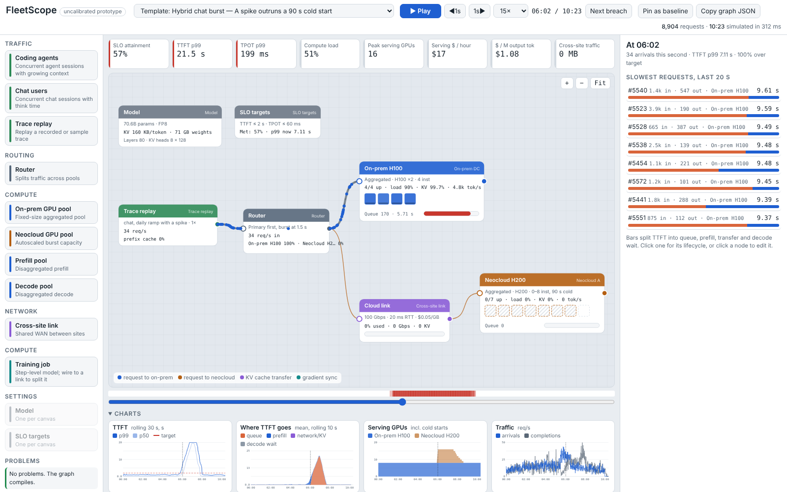
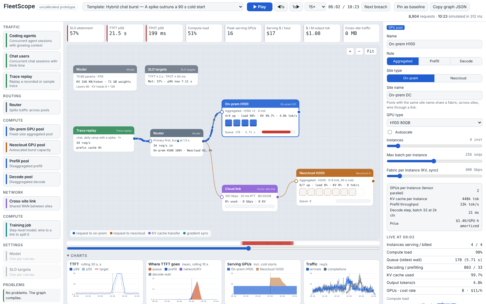
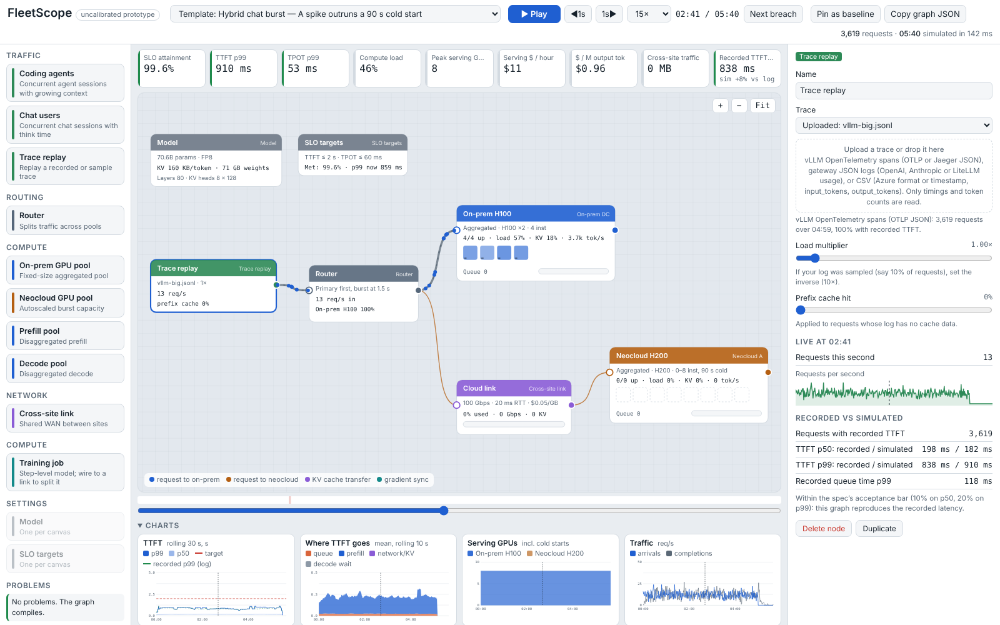

# FleetScope

A node-editor prototype for capacity planning on hybrid GPU fleets: on-prem plus neocloud. Drag traffic sources, routers, GPU pools, cross-site links and training jobs onto a canvas and wire them together. Press Play to replay traffic and watch requests, KV caches and gradient syncs move through the fleet. Change any knob and the whole trace re-simulates (usually in under half a second), keeping your place in the timeline.

> **Uncalibrated.** Performance comes from spec-sheet GPU figures and fixed efficiency factors (a first-order roofline), and the GPU prices are placeholders. Treat results as directional until profiles are calibrated against measured telemetry; see [docs/SPEC.md](docs/SPEC.md#calibration-against-real-telemetry).

## Run it

Open `dist/index.html` in a browser. It is a single self-contained file with no server and no install.

## Demo

These screenshots are of `dist/index.html` running its built-in templates. Synthetic traces only: no real traffic. All figures are uncalibrated spec-sheet estimates.

### Editor and live fleet

A hybrid fleet replaying a chat trace that spikes. The on-prem pool's KV cache is full (99.7%) and its queue is turning red. The neocloud's seven burst instances are still cold-starting (hatched). The right panel lists the slowest requests of the last 20 seconds, each bar split into queue and prefill time.



### Inspecting a pool

Click any node to edit its knobs in the details panel and see its live state at the playhead: instances, load, queue, KV use, throughput and cost, with sparklines over the run.



### Where one request's time went

Click a request for its lifecycle. This one waited 7.7 s in the queue, prefilled for 2 s, then decoded slowly in an overloaded batch.


### Prefill on-prem, decode in the neocloud

Every prompt's KV cache crosses a 100 Gbps link. The link sits at 100% and moves 4.1 TB in ten minutes. KV transfer (purple) dominates the TTFT breakdown, and the red strip under the canvas marks seconds that miss the TTFT target.


### Replaying real traces

Upload a log to the Trace replay node: vLLM OpenTelemetry spans, gateway JSON logs or CSV. When the log records TTFT, the run compares it with the simulation. Here, 3,619 vLLM spans give simulated p99 910 ms against 838 ms recorded (+8%), inside the spec's acceptance bar. See [docs/TRACES.md](docs/TRACES.md).



## Develop

```bash
cd fleetscope
npm test          # engine tests (Node 20+, no dependencies)
npm run build     # inline src/ into dist/index.html
```

| Path | What it is |
| --- | --- |
| `src/engine.js` | Simulation engine: GPU and model profiles, trace generators and the CSV parser, graph compiler, time-stepped simulator. Pure functions; runs in Node and the browser. |
| `src/templates.js` | Node catalogue (types, default knobs, palette) and the seven starter graphs |
| `src/ingest.js` | Trace import: vLLM OpenTelemetry spans (OTLP / Jaeger JSON), gateway JSON logs (OpenAI, Anthropic, LiteLLM), CSV; format detection; canonical CSV writer |
| `tools/convert-trace.mjs` | CLI that cuts a window from a large log, samples it, and writes canonical CSV |
| `src/index.src.html` | Editor UI: palette, pan/zoom canvas, wiring, details panel, live node rendering, charts, timeline |
| `build.mjs` | Inlines the engine, templates and importer into `dist/index.html` |
| `dist/index.html` | Built page, committed so it can be opened directly; regenerate with `npm run build` |
| `tests/` | Engine tests (determinism, causal ordering, conservation, per-template behaviour, profile maths) and import tests against fixtures for each log format |
| `docs/SPEC.md` | Product spec: goals, architecture, data model, engine, player, calibration, phases |
| `docs/TRACES.md` | How to capture and import real traces, and how recorded-vs-simulated comparison works |

## Nodes

| Node | Knobs |
| --- | --- |
| Coding agents / Chat users | Concurrent users, session length, starting context, tokens added per turn, output per turn, think or tool time, prefix-cache hit, duration (closed loop: a user's next turn waits for the previous answer) |
| Trace replay | Sample trace or an uploaded log: vLLM OpenTelemetry spans, gateway JSON logs (OpenAI / Anthropic / LiteLLM usage) or CSV ([docs/TRACES.md](docs/TRACES.md)); load multiplier; recorded or assumed prefix-cache hits. Logs with recorded TTFT are compared with the simulation. |
| Router | Primary first with a burst threshold, least estimated wait, or round robin; target priority |
| GPU pool | Role (aggregated, prefill, decode), site and site type, GPU type, fixed or autoscaled instances, cold start, scale thresholds, max batch, fabric bandwidth |
| Cross-site link | Bandwidth, round trip, egress price; shared by everything wired through it |
| Training job | Model, GPU type and count, global batch, MFU, sync overlap; wire it to a link to split it across sites |
| Model | Preset or custom parameters, active parameters, layers, KV heads × head dim (or MLA latent), weight and KV precision |
| SLO targets | TTFT and TPOT |

Wiring rules: traffic → router → pool or link; link → pool; prefill pool → decode pool or link; training job → link. The Problems panel explains anything that doesn't compile.

## How performance is estimated

For each pool's GPU type and the Model node:

- **GPUs per instance** = the smallest power of two whose combined HBM holds the weights at ≤ 65% of capacity.
- **Prefill rate** = GPUs × peak dense TFLOPS × 0.45 ÷ (2 × active parameters).
- **Decode step** = weight bytes read ÷ (GPUs × HBM bandwidth × 0.75) + 3 ms, plus a per-sequence compute term, plus KV bytes read for every token in the batch's context.
- **KV capacity** = (90% of HBM − weights) ÷ KV bytes per token.

Requests that don't fit an instance's KV cache are rejected. Training steps cost 6 × active parameters × tokens of compute, plus a full gradient copy (2 bytes per parameter) over the linked network when the job is split across sites.

## Known gaps

No automatic calibration yet (recorded-vs-simulated TTFT is shown, but profiles are not fitted), no closed-loop replay of recorded sessions, no prefix-cache locality across instances, no preemption when KV runs out mid-decode, training modelled per step rather than per collective. The spec's build phases cover what comes next.
