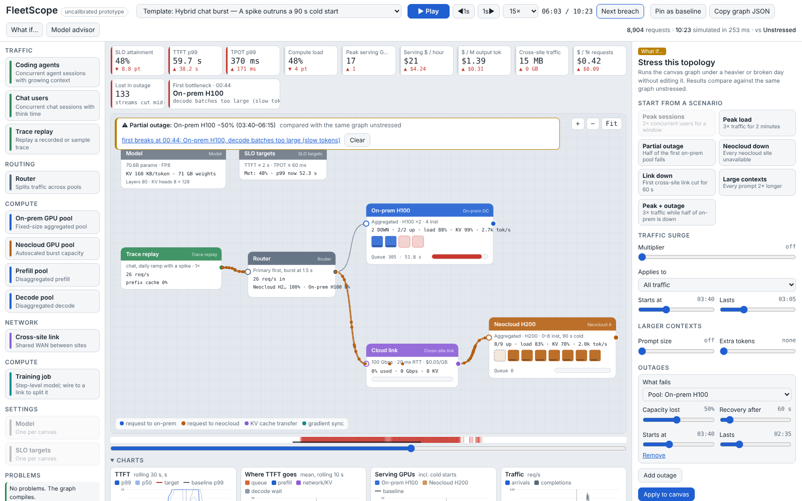
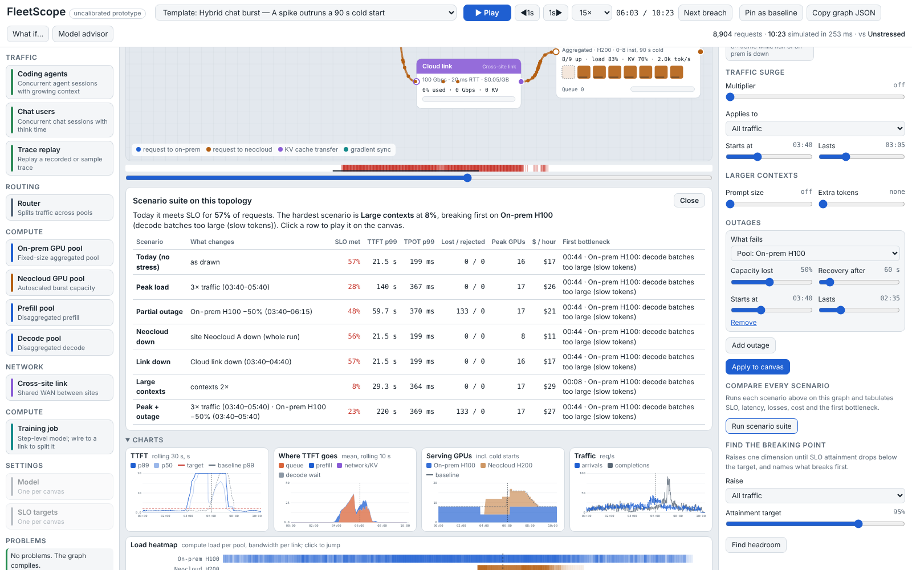

# FleetScope

A node-editor prototype for capacity planning on hybrid GPU fleets: on-prem plus neocloud. Drag traffic sources, routers, GPU pools, cross-site links and training jobs onto a canvas and wire them together. Press Play to replay traffic and watch requests, KV caches and gradient syncs move through the fleet. Change any knob and the whole trace re-simulates (usually in under half a second), keeping your place in the timeline.

> **Uncalibrated.** Performance comes from spec-sheet GPU figures and fixed efficiency factors (a first-order roofline), and the GPU prices are placeholders. Treat results as directional until profiles are calibrated against measured telemetry; see [docs/SPEC.md](docs/SPEC.md#calibration-against-real-telemetry).

## Run it

Open `dist/index.html` in a browser. It is a single self-contained file with no server and no install.

## Demo

The screenshots below come from `dist/index.html` with its built-in templates and sample traces; no real traffic is involved.

**Editor.** A hybrid fleet replaying a chat trace: the on-prem pool's KV cache fills during a spike, and the neocloud's instances are still cold-starting.


**What if… partial outage.** Half of the on-prem pool fails for two and a half minutes. Down instances show red, KPIs compare against the same graph unstressed, and the first bottleneck is named.



**Scenario suite.** Every stress scenario on the same graph, side by side.



**Breaking point.** With 10 on-prem instances, the graph holds 95% SLO attainment up to 1.33× today's traffic, then breaks on decode batch size (TPOT).


**Model advisor.** Coding-agent traffic: each candidate model and reasoning level is right-sized to the SLO and ranked by cost per 1,000 requests, with a quality floor from your own eval scores.


## Develop

```bash
cd fleetscope
npm test          # engine tests (Node 20+, no dependencies)
npm run build     # inline src/ into dist/index.html
```

| Path | What it is |
| --- | --- |
| `src/engine.js` | Simulation engine: GPU and model profiles, trace generators and the CSV parser, graph compiler, time-stepped simulator. Pure functions; runs in Node and the browser. |
| `src/templates.js` | Node catalogue (types, default knobs, palette) and the seven starter graphs |
| `docs/STRESS.md` | Stress overlays, bottleneck attribution, breaking-point search, model advisor, and how reasoning models change capacity and cost |
| `src/ingest.js` | Trace import: vLLM OpenTelemetry spans (OTLP / Jaeger JSON), gateway JSON logs (OpenAI, Anthropic, LiteLLM), CSV; format detection; canonical CSV writer |
| `tools/convert-trace.mjs` | CLI that cuts a window from a large log, samples it, and writes canonical CSV |
| `src/index.src.html` | Editor UI: palette, pan/zoom canvas, wiring, details panel, live node rendering, charts, timeline |
| `build.mjs` | Inlines the engine, templates and importer into `dist/index.html` |
| `dist/index.html` | Built page, committed so it can be opened directly; regenerate with `npm run build` |
| `tests/` | Engine tests (determinism, causal ordering, conservation, per-template behaviour, profile maths) and import tests against fixtures for each log format |
| `docs/SPEC.md` | Product spec: goals, architecture, data model, engine, player, calibration, phases |
| `docs/TRACES.md` | How to capture and import real traces, and how recorded-vs-simulated comparison works |

## Nodes

| Node | Knobs |
| --- | --- |
| Coding agents / Chat users | Concurrent users, session length, starting context, tokens added per turn, output per turn, think or tool time, prefix-cache hit, duration (closed loop: a user's next turn waits for the previous answer) |
| Trace replay | Sample trace or an uploaded log: vLLM OpenTelemetry spans, gateway JSON logs (OpenAI / Anthropic / LiteLLM usage) or CSV ([docs/TRACES.md](docs/TRACES.md)); load multiplier; recorded or assumed prefix-cache hits. Logs with recorded TTFT are compared with the simulation. |
| Router | Primary first with a burst threshold, least estimated wait, or round robin; target priority |
| GPU pool | Role (aggregated, prefill, decode), site and site type, GPU type, fixed or autoscaled instances, cold start, scale thresholds, max batch, fabric bandwidth |
| Cross-site link | Bandwidth, round trip, egress price; shared by everything wired through it |
| Training job | Model, GPU type and count, global batch, MFU, sync overlap; wire it to a link to split it across sites |
| Model | Preset or custom parameters, active parameters, layers, KV heads × head dim (or MLA latent), weight and KV precision, reasoning (hidden thinking tokens per request), keep thinking in context |
| SLO targets | TTFT and TPOT; whether streamed thinking counts as the first token |

## What if… and the model advisor

- **What if…** applies stress to the drawn graph without editing it: traffic or session surges in a time window, larger contexts, and outages of part of a pool, a whole site or a link. It includes a scenario suite and a breaking-point search ("holds 95% SLO up to 1.33× traffic, then breaks on…").
- **Model advisor** right-sizes the fleet for each candidate model and reasoning level and ranks them by cost per 1,000 requests at your SLO, with an optional quality floor from your evals.
- Every run names its **first bottleneck** (KV cache full, compute saturated, link saturated, cold starts, outage, or oversized decode batches).

Details, and how reasoning models change TTFT, capacity and cost: [docs/STRESS.md](docs/STRESS.md).

Wiring rules: traffic → router → pool or link; link → pool; prefill pool → decode pool or link; training job → link. The Problems panel explains anything that doesn't compile.

## How performance is estimated

For each pool's GPU type and the Model node:

- **GPUs per instance** = the smallest power of two whose combined HBM holds the weights at ≤ 65% of capacity.
- **Prefill rate** = GPUs × peak dense TFLOPS × 0.45 ÷ (2 × active parameters).
- **Decode step** = weight bytes read ÷ (GPUs × HBM bandwidth × 0.75) + 3 ms, plus a per-sequence compute term, plus KV bytes read for every token in the batch's context.
- **KV capacity** = (90% of HBM − weights) ÷ KV bytes per token.

Requests that don't fit an instance's KV cache are rejected. Training steps cost 6 × active parameters × tokens of compute, plus a full gradient copy (2 bytes per parameter) over the linked network when the job is split across sites.

## Known gaps

No automatic calibration yet (recorded-vs-simulated TTFT is shown, but profiles are not fitted), no closed-loop replay of recorded sessions, no prefix-cache locality across instances, no preemption when KV runs out mid-decode, training modelled per step rather than per collective. The spec's build phases cover what comes next.
