# FleetScope

A node-editor prototype for capacity planning on hybrid GPU fleets: on-prem plus neocloud. Drag traffic sources, routers, GPU pools, cross-site links and training jobs onto a canvas and wire them together. Press Play to replay traffic and watch requests, KV caches and gradient syncs move through the fleet. Change any knob and the whole trace re-simulates (usually in under half a second), keeping your place in the timeline.

> **Uncalibrated.** Performance comes from spec-sheet GPU figures and fixed efficiency factors (a first-order roofline), and the GPU prices are placeholders. Treat results as directional until profiles are calibrated against measured telemetry; see [docs/SPEC.md](docs/SPEC.md#calibration-against-real-telemetry).

## Run it

Open `dist/index.html` in a browser. It is a single self-contained file with no server and no install.

## From the command line

The same simulator runs headless, for scripts, CI and LLM agents (every command takes `--json`):

```bash
node tools/fleetscope.mjs templates                                   # built-in fleets
node tools/fleetscope.mjs run --template burst                        # stress suite: SLO, TTFT/TPOT p99, cost, peak GPUs, first bottleneck
node tools/fleetscope.mjs run --scenario scenarios/hybrid-chat --trace requests.jsonl   # replay your own request log
node tools/fleetscope.mjs ask "What if the cloud link drops to 25 Gbps?" --template xpd -o edited.json
node tools/fleetscope.mjs compare --base scenarios/prod --head scenarios/proposed
```

## Starting from Inference Sizer

[Inference Sizer](../inference-sizer/) recommends GPUs, layout and pools for a model at TTFT/TPOT targets. Its **Export to FleetScope** writes a graph with the model, targets, matching traffic and pools, with GPUs per instance set. **Load graph JSON** opens it here, to replay against bursts, cold starts and failures. A pool's **GPUs per instance** (0 = auto) sets tensor parallelism explicitly.

## Demo

These screenshots are of `dist/index.html` running its built-in templates. Synthetic traces only: no real traffic. All figures are uncalibrated spec-sheet estimates.

### Editor and live fleet

A hybrid fleet replaying a chat trace that spikes. The on-prem pool's KV cache is full (99.7%) and its queue is turning red. The neocloud's seven burst instances are still cold-starting (hatched). The right panel ranks this run's bottlenecks and lists the slowest requests of the last 20 seconds. The *First bottleneck* tile jumps to the moment it starts.


### Inspecting a pool

Click any node to edit its knobs in the details panel and see its live state at the playhead: instances, load, queue, KV use, throughput and cost, with sparklines over the run.


### Where one request's time went

Click a request for its lifecycle. This one waited 7.7 s in the queue, prefilled for 2 s, then decoded slowly in an overloaded batch.

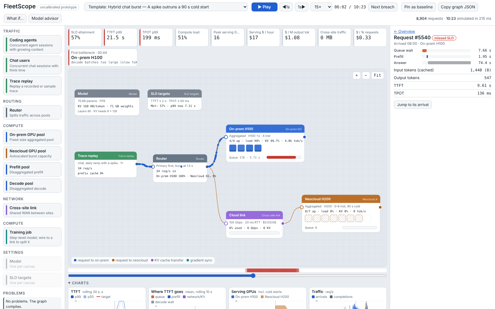

### Prefill on-prem, decode in the neocloud

Every prompt's KV cache crosses a 100 Gbps link. The link sits at 100% and moves 4.1 TB in ten minutes. KV transfer (purple) dominates the TTFT breakdown, and the red strip under the canvas marks seconds that miss the TTFT target.

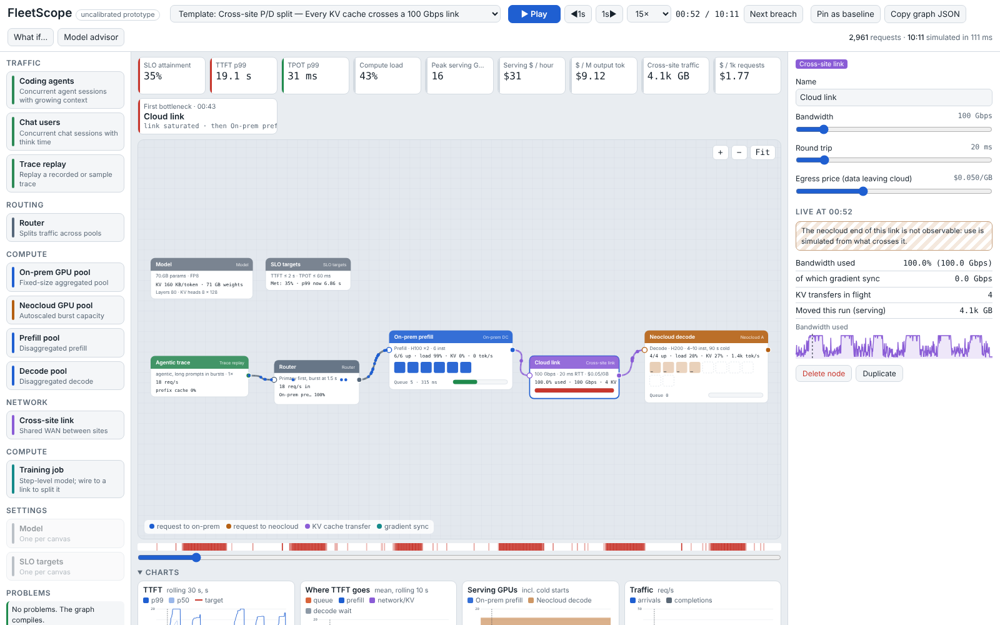

### Replaying real traces

Upload a log to the Trace replay node: vLLM OpenTelemetry spans, gateway JSON logs or CSV. When the log records TTFT, the run compares it with the simulation. Here, 3,619 vLLM spans give simulated p99 910 ms against 838 ms recorded (+8%), inside the spec's acceptance bar. See [docs/TRACES.md](docs/TRACES.md).


### Closed-loop replay of recorded sessions

A recorded agent log (150 sessions, 1,516 turns) replayed as sessions: each turn waits for the previous answer and keeps the recorded think time between them, so a slower fleet sees less traffic instead of an impossible backlog. On 4 on-prem H100s, turns run a median 16 s behind the log, and simulated TTFT p99 is 9.6 s against 1.2 s recorded: this fleet is far slower than the one that produced the log. Replaying the same log by timestamps gives a p99 of 34 s. See [docs/TRACES.md](docs/TRACES.md#closed-loop-replay).

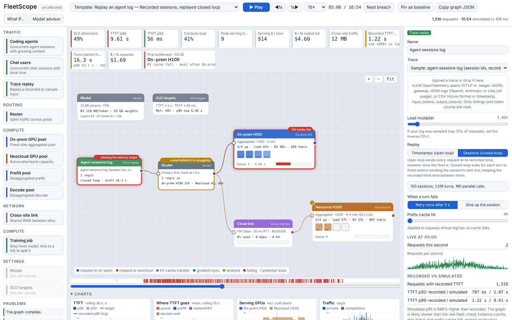

### Health colouring and potential issues

During playback each node's frame turns amber when strained and red when failing, with the cause on a badge (KV cache full, queueing, link saturated, instances down); wires into a failing node turn red too. The node blamed for an SLO breach that second is always red. Before anything runs, potential issues are flagged with an **!** on the node and listed under Problems: a neocloud that starts empty with a cold start longer than a burst, prefill demand near pool capacity at peak, KV demand above a link's bandwidth, contexts larger than an instance's KV cache, single pools behind a router, training sharing a link with serving.

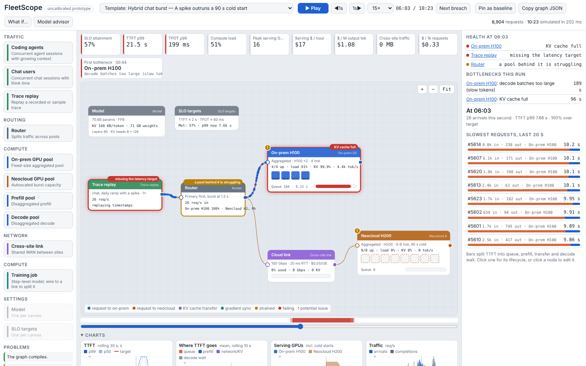

### Lenses: latency, cost, reliability

The tabs above the canvas switch what the colours mean. **Performance** is the health view above. The other lenses shade each node from neutral to the lens colour, put a figure on its badge, and summarise in one line. Latency and Cost can cover the ten seconds up to the playhead or the whole run.

**Latency** splits time to first token across the nodes requests pass through. Here, in the cross-site P/D template at 02:25, requests waited a mean 2.2 s. Two thirds of that was prefill on-prem; a third was KV caches crossing the link.

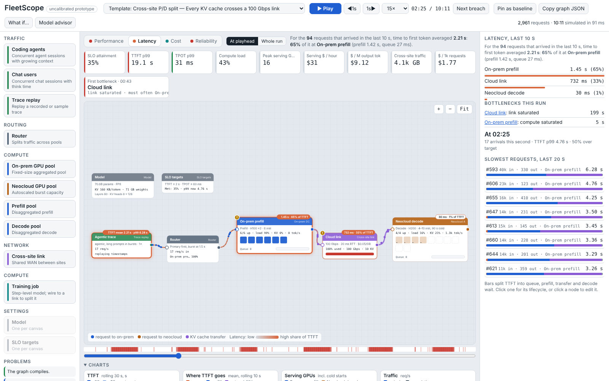

**Cost** shows GPU spend per pool, with the share paid for idle GPUs, plus egress per link. In the training template the run costs $155 for ten minutes. The serving pools are 4% of that; gradient sync egress over the link is 43%.

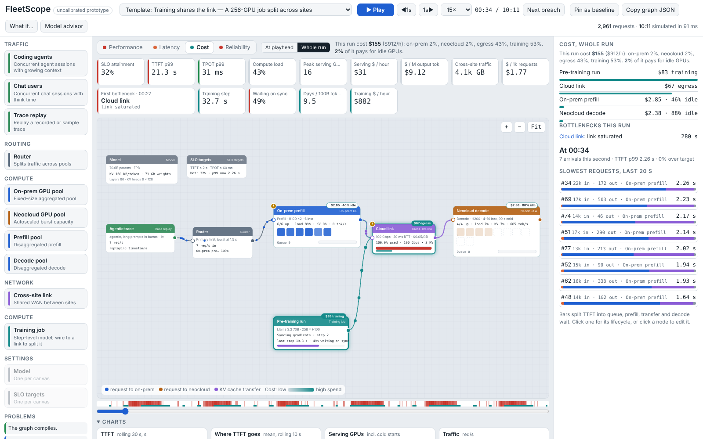

**Reliability** fails each pool, link and site for the whole run in the background, then shows the SLO each one would cost. With two neoclouds, losing on-prem drops SLO from 70% to 6%; losing either neocloud costs 6 to 17 points.

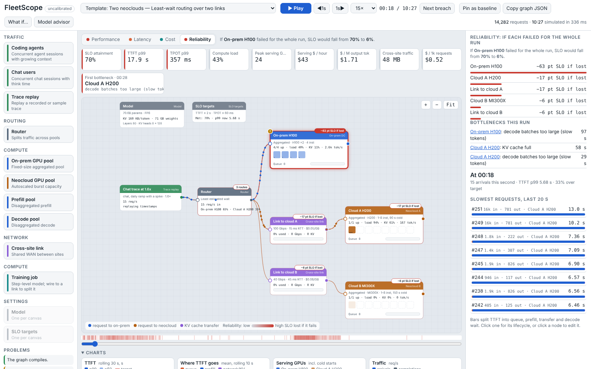

### Security and ownership lenses

**Security** tracks where each data class runs and travels. Each traffic source has a data class (public, internal, confidential). Each pool has a trust zone (private, dedicated cloud, shared cloud) and each link an encryption setting. The SLO node holds the policy; by default confidential data stays on private sites and non-public data crosses only encrypted links. In the coding-agent template the agents send confidential code: 34% of requests burst to the shared neocloud and break the rule. The lint flags the router before you press Play.

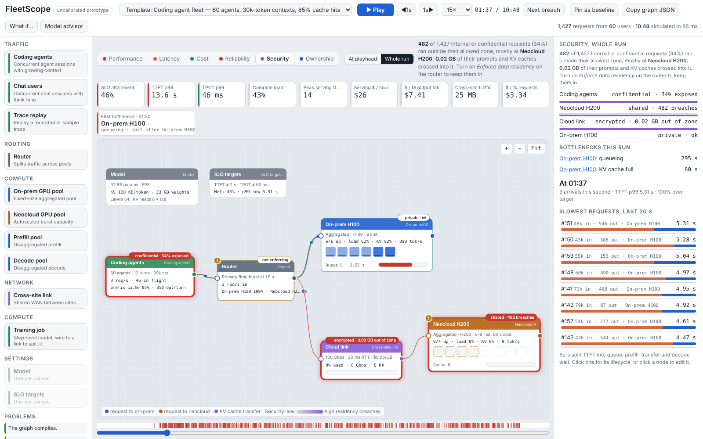

Turn on **Enforce data residency** on the router and nothing leaves on-prem, but SLO attainment falls from 46% to 15%. The neocloud also still autoscales on on-prem queue pressure with no traffic it may take, so the Cost lens shows its GPUs fully idle.

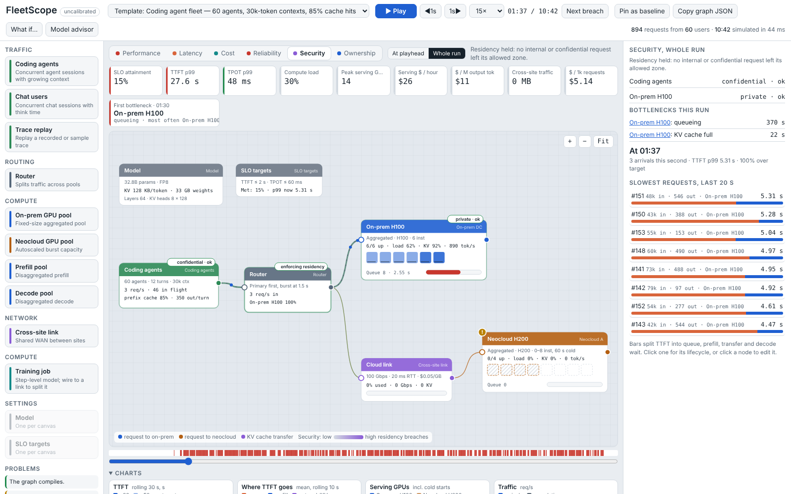

**Ownership** colours each node by its owner team and shows the on-call. It ranks teams by spend and by how many breach seconds their nodes carried, and flags nodes with no owner. In the training template, Foundation Models owns 53% of the spend, while Network Engineering owns the link that is the first bottleneck.

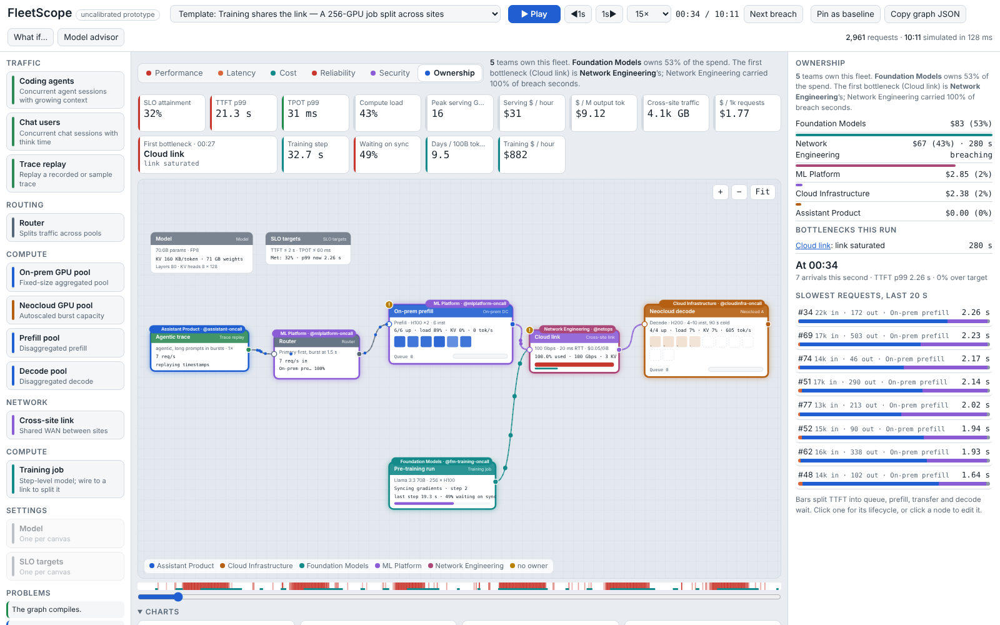

### Cluster view: Kubernetes scheduling

The **Cluster** tab switches to the Kubernetes layer: node pools and IB domains drawn GPU by GPU, Kueue-style queues with quotas, and inference, training and batch workloads. A scheduler policy (bin-pack or spread, gang, topology-aware, preemption, borrowing, FIFO order) decides who gets which GPU. On the sample cluster under spread placement, inference and evaluation pods land on every node. The 160-GPU pre-training gang never finds room in one IB domain; 2,347 GPU-hours sit stranded and allocation is 38%. See [docs/CLUSTER.md](docs/CLUSTER.md).

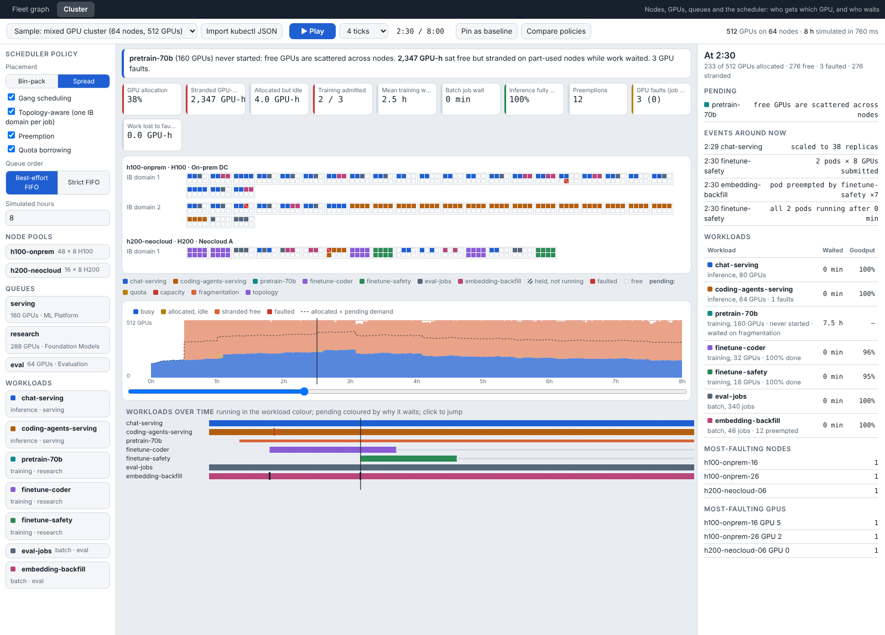

**Compare policies** runs every single policy change side by side. Bin-pack starts all three training jobs and lifts allocation to 61%. Strict FIFO starts none.

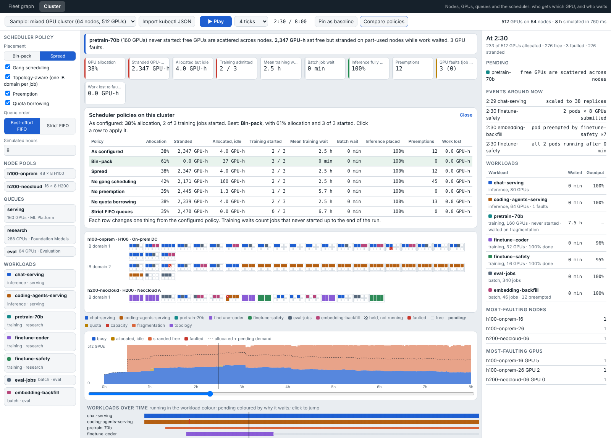

Clicking Bin-pack applies it and compares against the configured policy: no stranded GPUs, 2.5 h less training wait. Faulted GPUs show red, and the most-faulting nodes and GPUs are ranked. A real cluster can be imported from `kubectl get nodes,pods,clusterqueues,localqueues -A -o json`.

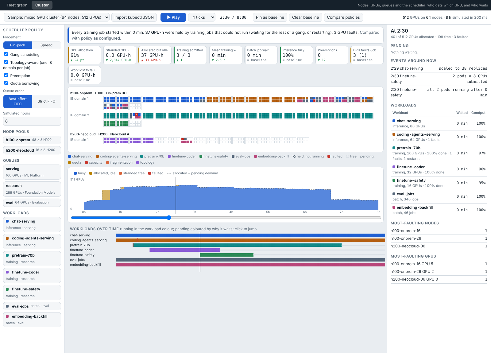

### Training view: GPUs, phases, scheduling, full view

The **Training** tab follows one job step by step and shows it four ways: by GPU, by phase of the step, by scheduling, and all at once with a headline naming the bottleneck. For Llama 3.3 70B on 160 H100s, one GPU 12% slow holds every step and costs 9% of wall time. Switching to a video-and-image data mix at hour 4 exposes 3 s of decode per step. One GPU fault moves the job to a hot spare and costs 43 minutes. See [docs/TRAINING.md](docs/TRAINING.md).

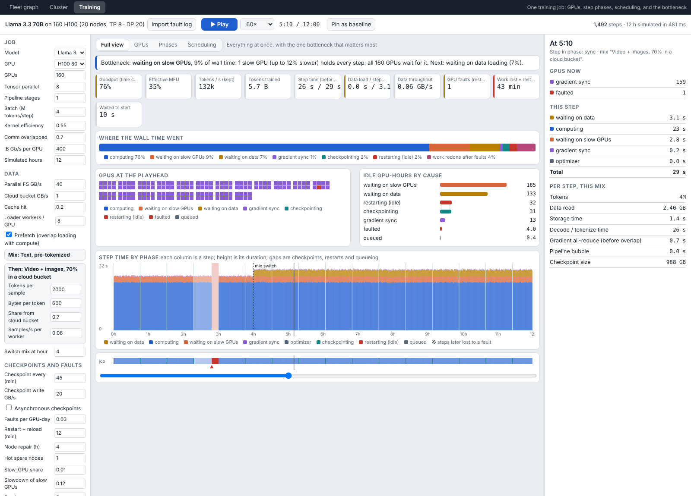

The GPU view at one instant: 158 GPUs wait while the slow one finishes its share of the step.

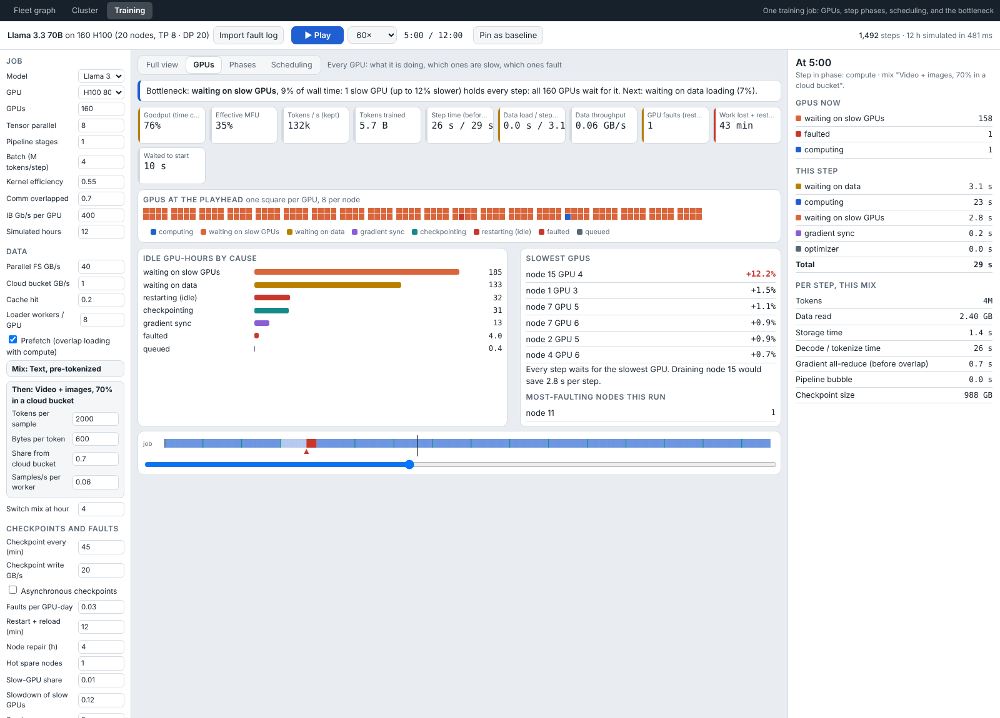

The scheduling view checks constraints and runs the job through the Cluster tab's scheduler.

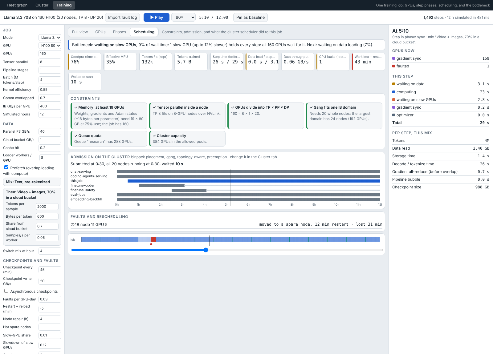

### Inference view: replicas, start-up and contention

The **Inference** tab shows serving deployments as pods on the cluster: target replicas against replicas ready to serve, what a new replica's start-up time goes on, and who holds the GPUs. If pre-training outranks serving, its gang preempts 49 chat replicas at 0:30 and serving runs 64% short. Each replacement takes 4 minutes to serve, mostly loading weights from the object store. See [docs/INFERENCE.md](docs/INFERENCE.md).

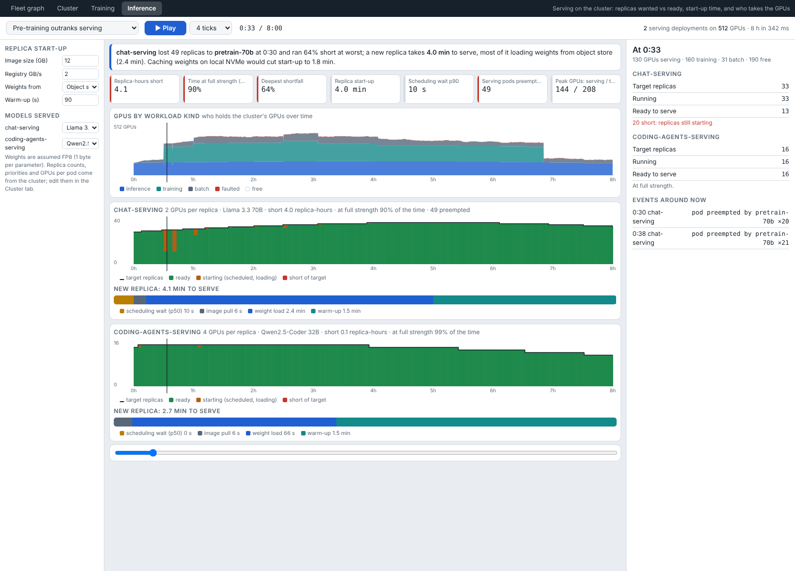

### Calibration

**Calibrate** fits a pool's prefill and decode speed to measurements, then checks the spec's acceptance bar (10% at p50, 20% at p99). Measurements can come from a recorded trace, a vLLM `/metrics` snapshot or a `benchmark_serving` result. Here a `/metrics` snapshot shows the on-prem pool running slower than its spec sheet: the fit lands on prefill ×0.78 and decode ×1.34, and every metric comes inside the bar. The Training tab fits kernel efficiency, comm overlap and dataloader rate from step timings. See [docs/CALIBRATION.md](docs/CALIBRATION.md).

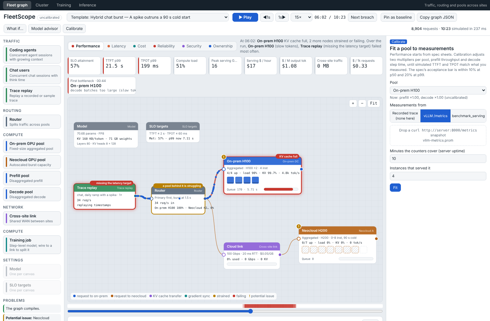

### Live twin

**Live** forecasts traffic from metrics history (Prometheus or an export) with a daily pattern and trend. It runs the forecast through the graph, lists predicted breaches with where and why, and scores past forecasts against what happened. Run `tools/live-twin.mjs` on a schedule to post the same alerts to Slack or Lark. See [docs/LIVE.md](docs/LIVE.md).

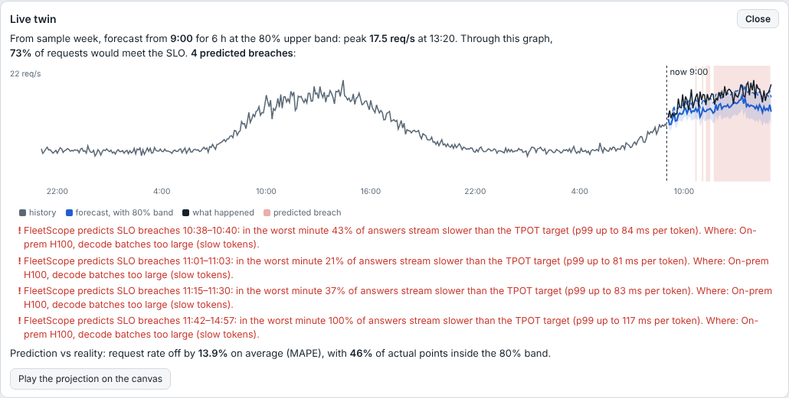

### One scenario across the views

The views share one clock and one change set. **Pin all as baseline** pins every view; the view bar then lists each change since, in any view, and can reset them all. A fleet pool can take its capacity from a cluster workload. Here the on-prem pool follows `chat-serving` after the Cluster tab gives pre-training priority over serving: the gang preempts the chat replicas, and fleet SLO attainment falls from 57% to 27%. See [docs/SCENARIO.md](docs/SCENARIO.md).

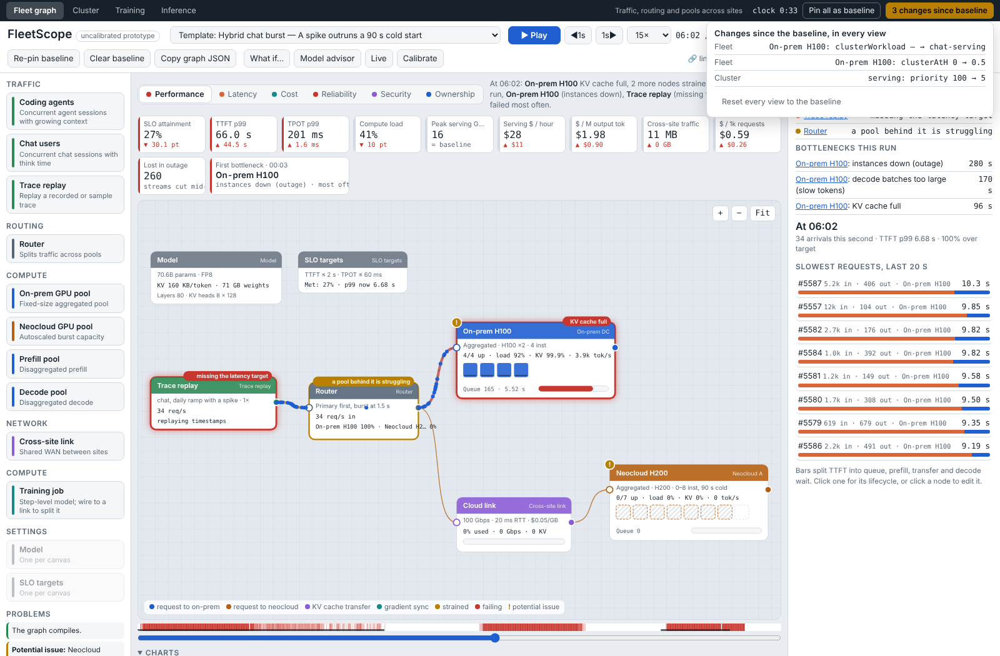

### CI gate and reports

Scenarios in `scenarios/` are planned on every pull request that changes them. The workflow runs base and head, lists what changed and who owns it, comments the plan on the PR, and fails when a threshold is crossed. **Report** in the browser plans the current setup against the pinned baseline. Here, two more on-prem instances plus bin-pack placement lift SLO met from 56.9% to 83.4% and GPU allocation from 38% to 61%. See [docs/CI.md](docs/CI.md).

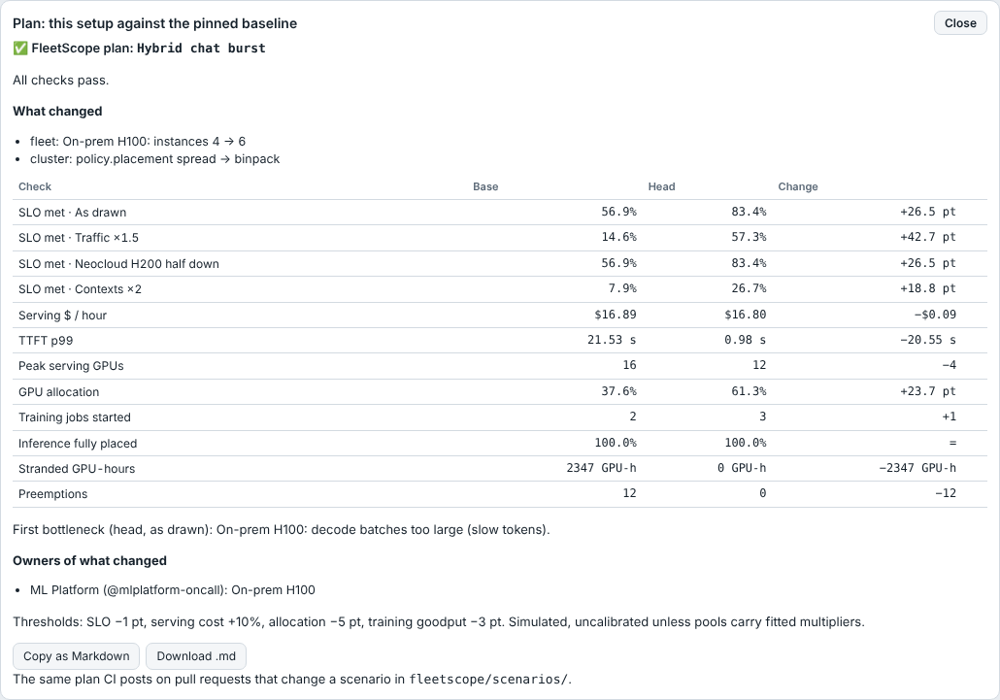

### Richer physics

Opt-in knobs model:
- **Serving:** prefix-cache locality with cache-oblivious or KV-aware routing, CPU KV offload, speculative decoding, LoRA adapters, MoE all-to-all.
- **Training:** elastic jobs, power caps with energy, two-site gradient sync.

Here the coding-agent fleet's router switches from cache-oblivious to KV-aware routing with CPU offload, and SLO met rises from 10% to 78%. See [docs/PHYSICS.md](docs/PHYSICS.md).

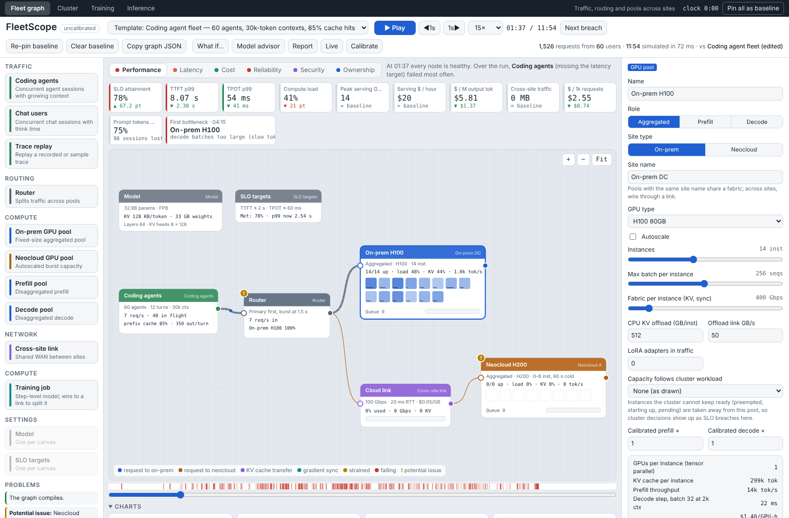

### Plan and optimise

**Plan** finds the cheapest setup that meets the SLO target, the residency rule and an optional N-1 floor. On the burst graph that's 6 B200 instances at $19/h. Plan also compares renting, reserving and buying the base load over 24 months, and packs small models onto MIG slices. See [docs/PLANNING.md](docs/PLANNING.md).

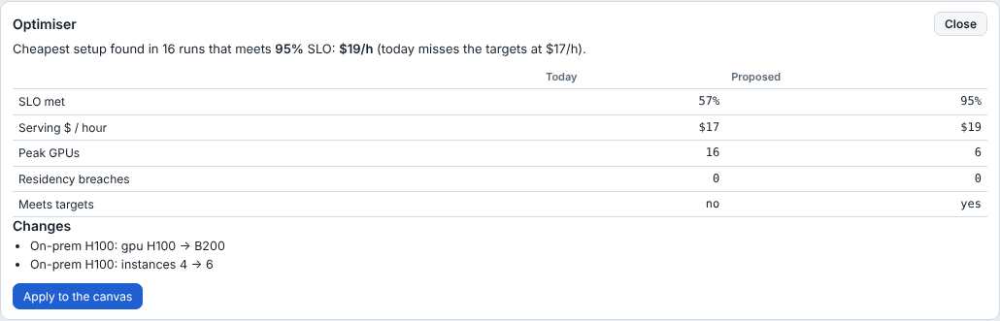

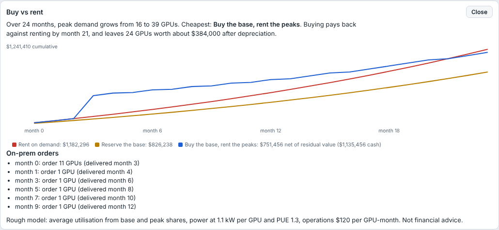

### Ask in plain English

Type a what-if in the box at the top, such as "What if coding agents move to H200 and the cloud link drops to 25 Gbps?". FleetScope shows how it read the question, runs it against the current graph and answers with before and after numbers. **Apply to the canvas** keeps the change. The parser is rule-based and runs in the page, so no question leaves the browser. See [docs/ASK.md](docs/ASK.md).

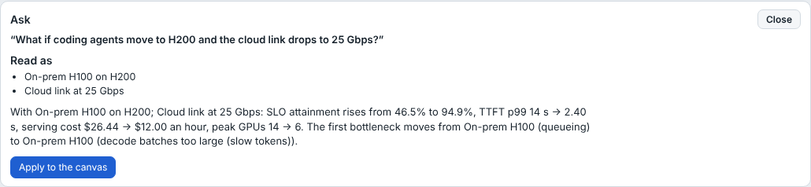

### What if… a partial outage

Half of the on-prem pool fails for two and a half minutes. Down instances show red, streams cut mid-answer are counted as lost, the KPIs compare against the same graph unstressed, and the banner names where it breaks first. See [docs/STRESS.md](docs/STRESS.md).


### Every scenario side by side

The scenario suite runs peak load, partial outage, neocloud down, link down, large contexts, and peak load plus an outage on the same graph. On this one, losing the neocloud barely matters (its cold start was too slow to help anyway); doubling context length is the real threat.


### Breaking point

With 10 on-prem instances, the graph holds 95% SLO attainment up to 1.33× today's traffic. At 1.44× it breaks on decode batch size (TPOT).

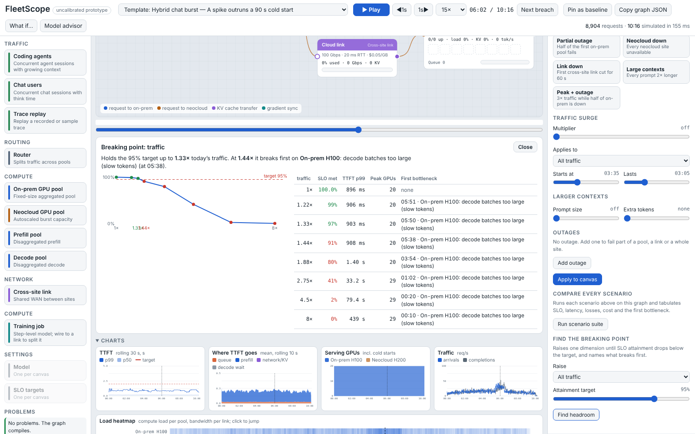

### Model advisor

Coding-agent traffic. Each candidate model and reasoning level is right-sized to the SLO and ranked by cost per 1,000 requests, with a quality floor taken from your own eval scores.

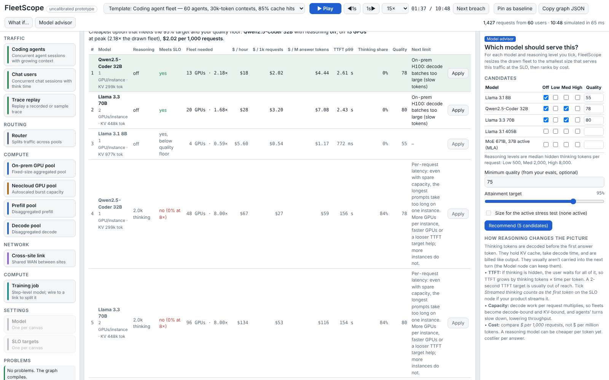

## Develop

```bash
cd fleetscope
npm test          # engine tests (Node 20+, no dependencies)
npm run build     # inline src/ into dist/index.html
```

| Path | What it is |
| --- | --- |
| `src/engine.js` | Simulation engine: GPU and model profiles, trace generators and the CSV parser, graph compiler, time-stepped simulator. Pure functions; runs in Node and the browser. |
| `src/templates.js` | Node catalogue (types, default knobs, palette) and the seven starter graphs |
| `docs/STRESS.md` | Stress overlays, bottleneck attribution, breaking-point search, model advisor, and how reasoning models change capacity and cost |
| `src/ingest.js` | Trace import: vLLM OpenTelemetry spans (OTLP / Jaeger JSON), gateway JSON logs (OpenAI, Anthropic, LiteLLM), CSV; format detection; canonical CSV writer |
| `tools/convert-trace.mjs` | CLI that cuts a window from a large log, samples it, and writes canonical CSV |
| `src/index.src.html` | Editor UI: palette, pan/zoom canvas, wiring, details panel, live node rendering, charts, timeline |
| `build.mjs` | Inlines the engine, templates and importer into `dist/index.html` |
| `dist/index.html` | Built page, committed so it can be opened directly; regenerate with `npm run build` |
| `tests/` | Engine tests (determinism, causal ordering, conservation, per-template behaviour, profile maths), import tests against fixtures for each log format, stress tests, and closed-loop replay and lint tests |
| `docs/SPEC.md` | Product spec: goals, architecture, data model, engine, player, calibration, phases |
| `docs/TRACES.md` | How to capture and import real traces, and how recorded-vs-simulated comparison works |
| `src/cluster.js`, `src/cluster-ui.js` | Cluster engine (scheduler, quotas, faults, kubectl import) and the Cluster view |
| `docs/CLUSTER.md` | The cluster model, policy knobs, and importing a real cluster |
| `src/training.js`, `src/training-ui.js` | Training job model (phases, data loading, stragglers, checkpoints, faults) and the Training view |
| `src/optimize.js`, `docs/PLANNING.md` | Optimiser, buy-vs-rent planner, MIG packing |
| `src/ask.js`, `docs/ASK.md` | Reads plain-English what-ifs into graph edits and stress tests, and answers them |
| `src/plan.js`, `tools/fleetscope-plan.mjs`, `scenarios/`, `docs/CI.md` | Plans base vs head scenarios for CI and the Report button |
| `src/scenario.js`, `docs/SCENARIO.md` | Shared clock, change set across views, and fleet pools linked to cluster workloads |
| `src/forecast.js`, `tools/live-twin.mjs`, `docs/LIVE.md` | Forecasts, projections, predicted-breach alerts and the scheduled CLI |
| `src/calibrate.js`, `docs/CALIBRATION.md` | Fitting pools to vLLM metrics, benchmarks and recorded traces; training step timings |
| `docs/TRAINING.md` | The training model, the four sub-views, and fault-log import |
| `src/inference-ui.js`, `docs/INFERENCE.md` | The Inference view and its start-up model |

## Nodes

Every traffic, router, pool, link and training node also has an owner team and an on-call handle.

| Node | Knobs |
| --- | --- |
| Coding agents / Chat users | Data class; concurrent users, session length, starting context, tokens added per turn, output per turn, think or tool time, prefix-cache hit, duration (closed loop: a user's next turn waits for the previous answer) |
| Trace replay | Data class; sample trace or an uploaded log: vLLM OpenTelemetry spans, gateway JSON logs (OpenAI / Anthropic / LiteLLM usage) or CSV ([docs/TRACES.md](docs/TRACES.md)); load multiplier; recorded or assumed prefix-cache hits; replay by timestamps (open loop) or by session (closed loop), and whether a session retries or gives up after a failed turn. Logs with recorded TTFT are compared with the simulation. |
| Router | Primary first with a burst threshold, least estimated wait, or round robin; target priority; enforce data residency |
| GPU pool | Role (aggregated, prefill, decode), site and site type, trust zone, GPU type, fixed or autoscaled instances, cold start, scale thresholds, max batch, fabric bandwidth |
| Cross-site link | Bandwidth, round trip, egress price, encryption; shared by everything wired through it |
| Training job | Model, GPU type and count, global batch, MFU, sync overlap; wire it to a link to split it across sites |
| Model | Preset or custom parameters, active parameters, layers, KV heads × head dim (or MLA latent), weight and KV precision, reasoning (hidden thinking tokens per request), keep thinking in context |
| SLO targets | TTFT and TPOT; whether streamed thinking counts as the first token; data residency policy (where confidential and internal data may run, encrypted links only) |

## What if… and the model advisor

- **What if…** applies stress to the drawn graph without editing it: traffic or session surges in a time window, larger contexts, and outages of part of a pool, a whole site or a link. It includes a scenario suite and a breaking-point search ("holds 95% SLO up to 1.33× traffic, then breaks on…").
- **Model advisor** right-sizes the fleet for each candidate model and reasoning level and ranks them by cost per 1,000 requests at your SLO, with an optional quality floor from your evals.
- Every run names its **first bottleneck** (KV cache full, compute saturated, link saturated, cold starts, outage, or oversized decode batches), and the canvas colours each node by its health second by second.
- **Potential issues** are found from the graph and traffic before running and marked with an **!** on the node.

Details, and how reasoning models change TTFT, capacity and cost: [docs/STRESS.md](docs/STRESS.md).

Wiring rules: traffic → router → pool or link; link → pool; prefill pool → decode pool or link; training job → link. The Problems panel explains anything that doesn't compile.

## How performance is estimated

For each pool's GPU type and the Model node:

- **GPUs per instance** = the smallest power of two whose combined HBM holds the weights at ≤ 65% of capacity.
- **Prefill rate** = GPUs × peak dense TFLOPS × 0.45 ÷ (2 × active parameters).
- **Decode step** = weight bytes read ÷ (GPUs × HBM bandwidth × 0.75) + 3 ms, plus a per-sequence compute term, plus KV bytes read for every token in the batch's context.
- **KV capacity** = (90% of HBM − weights) ÷ KV bytes per token.

Requests that don't fit an instance's KV cache are rejected. Training steps cost 6 × active parameters × tokens of compute, plus a full gradient copy (2 bytes per parameter) over the linked network when the job is split across sites.

## Known gaps

Calibration fits two multipliers per pool, not every term of the model; no preemption when KV runs out mid-decode, training modelled per step rather than per collective. The spec's build phases cover what comes next.
