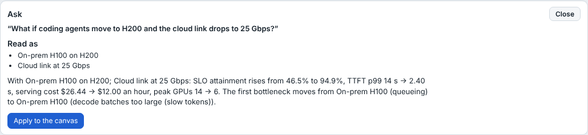

# Ask in plain English

The box at the top of the fleet view takes a what-if question and answers it against the graph on the canvas.

```
What if coding agents move to H200 and the cloud link drops to 25 Gbps?
```

FleetScope answers in three parts:

- **Read as** lists the edits and stress test it understood, such as `On-prem H100 on H200` and `Cloud link at 25 Gbps`.
- **The answer** gives SLO attainment, TTFT p99, serving cost and peak GPUs before and after, and says where the first bottleneck moves.
- **Not used** lists any words it could not match, so a misread is visible instead of silently guessed.

**Apply to the canvas** copies the edited graph, and any stress test, into the editor so you can keep working from it.



## What it understands

| Kind | Examples |
|---|---|
| GPU type | "coding agents move to H200", "move on-prem to B200" |
| Instances | "add 4 instances to on-prem", "neocloud can scale to 16 instances", "double the cloud pool", "with a 30 s cold start" |
| Links | "the cloud link drops to 25 Gbps", "cut the link to 10 gbps" |
| Traffic | "double the traffic", "3x traffic", "contexts grow 2x" |
| Outages | "half of on-prem goes down", "the cloud link fails", "lose the neocloud" |
| Model | "use Llama 3.1 405B", "with high reasoning" |
| Targets | "set the TTFT target to 1 s", "TPOT target 50 ms" |
| Serving features | "turn on KV-aware routing", "least-wait", "round robin", "speculative decoding", "CPU offload", "enforce residency" |

Names match a node's label, its site (on-prem, cloud, neocloud) or the traffic source that feeds it ("coding agents" finds the pool the agent traffic goes to). A phrase containing "link" only matches links. If a value is already set, the answer says so instead of reporting a change.

## How it works

`src/ask.js` exports:

- `parse(question, graph)` returns `{ graph, edits, notes, stress, understood, ignored }`. It never changes the graph passed in.
- `answer(question, graph, { traceLookup, stress })` runs the engine on the original and the edited graph and adds `before`, `after` and `text`.
- `EXAMPLES` lists sample questions; they fill the box's suggestions.

The parser is a set of regular expressions, not a language model, so it runs offline and gives the same answer every time. A model front end could later produce the same edit list, and the rest would not change.

## Limits

- One question can combine several edits but at most one stress test.
- Comparisons ("which is cheaper, H200 or B200?") are not read; ask each and compare, or use Plan → Optimise.
- Cluster and Training views are not covered yet; questions apply to the fleet graph.
