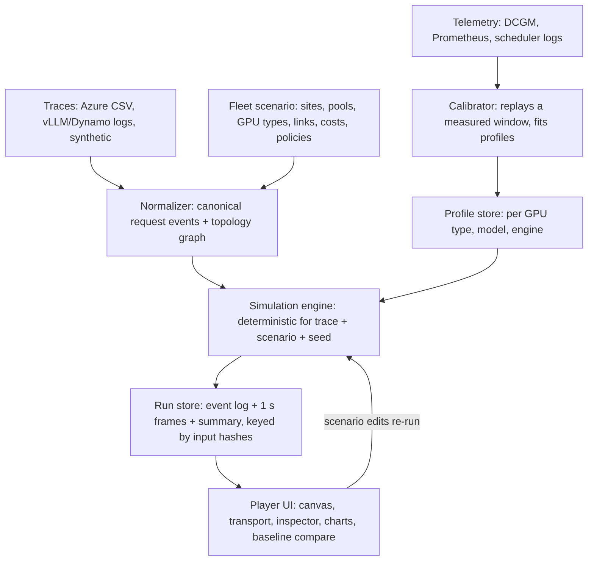

# FleetScope spec: replay, dissect and redesign hybrid GPU fleets

FleetScope (working name) replays recorded traffic against a modelled GPU fleet that spans on-prem and neocloud sites. Planners can pause on any moment, dissect where time went, then switch topology or serving architecture and compare outcomes on the same trace.

The living version of this spec is a Claude doc; this file is a snapshot from 2026-11-17.

## Goals, non-goals and users

The goal is to make a capacity decision visible before money is spent. You should see the decision play out on your own traffic, not read it off a spreadsheet.

**Goals**

- Replay real request traces (Azure LLM trace format, vLLM/Dynamo request logs, or a generic CSV) against a modelled fleet.
- Animate the fleet as it serves the trace: routing, queues, GPU utilization, KV cache use, cross-site transfers.
- Pause, single-step and scrub to any second. Click a pool or a request to see why it is slow.
- Swap topology (sites, GPU types, counts, links) or serving architecture (aggregated, disaggregated, cross-site disaggregated). Re-run on the same trace and seed.
- Pin one scenario as a baseline and compare SLO attainment, tail latency, utilization and cost.
- Calibrate the model against measured telemetry so the comparisons can be trusted.

**Non-goals (v1)**

- Kernel-level or cycle-accurate simulation. FleetScope calls out to AIConfigurator, Vidur or SimAI for that.
- Live production control. It plans; schedulers like Run:ai, Kueue and SkyPilot act.
- Per-collective training simulation. v1 models a training job per step (compute plus gradient sync), which is enough to show what a job split across sites does to a shared link.

**Users and their questions**

| User | Typical question |
| --- | --- |
| Capacity planner | How many GPUs of which type, and where, keep p99 TTFT under target for next quarter's traffic? |
| Platform / SRE lead | Why did TTFT spike at 14:05 yesterday: queueing, prefill, or the cross-site link? |
| Finance / procurement | What does bursting to the neocloud cost compared with buying more on-prem GPUs? |
| Serving engineer | Does disaggregated prefill/decode beat aggregated serving on our traffic mix? |

## Architecture

The player never simulates live. It replays a run that the engine computed and cached. Pausing, scrubbing and comparing are just lookups, so a scenario edit costs one re-run.



Runs are keyed by a hash of trace, scenario and seed. The same inputs always give the same run, which is what makes A/B comparisons fair.

## Data model

There are four inputs, all plain files under version control: a trace, a fleet scenario, GPU profiles and policies. A run is fully described by the three content hashes (trace, scenario with its policies, profiles) plus the seed.

| Entity | Key fields | Source |
| --- | --- | --- |
| Request event | request_id, arrival_ts, input_tokens, output_tokens, model, tenant, slo_class, prefix_hash (optional) | Azure LLM trace CSV, vLLM/Dynamo request logs, gateway logs, synthetic generators |
| Training job (phase 3) | job_id, submit_ts, gpus, gpu_type, est_duration, comm_pattern | Slurm/K8s job history |
| Site | id, kind (on-prem / neocloud), telemetry_level (full / vm-only) | Scenario file |
| Pool | id, site, gpu_type, gpus_per_instance, min/max instances, role (aggregated / prefill / decode), cold_start_s, usd_per_gpu_hr | Scenario file |
| Link | from_site, to_site, gbps, rtt_ms, egress_usd_per_gb | Scenario file |
| GPU profile | gpu_type, model, engine, prefill_tok_s, decode step time = a + b × batch, kv_capacity_tokens, kv_bytes_per_token, source (aiconfigurator / measured / calibrated) | Profile store |
| Policy | router (least queue / on-prem first with burst threshold / cost first), autoscaler targets and delays, admission limits | Scenario file |

The prototype stores scenarios as graph JSON (nodes with knobs, plus wires); **Copy graph JSON** exports it.

## Simulation engine

The default engine is time-stepped, with dt = 50 ms of simulated time. Every random choice comes from one seeded generator, so a trace, scenario and seed always produce the same run.

Each step runs in this order:

1. **Arrivals.** Requests whose arrival time has passed enter their router. Closed-loop users (agents, chat) issue their next turn only after the previous answer plus think or tool time.
2. **Routing.** The policy picks a pool. A prefill pool picks its decode pool when prefill ends. Going through a link adds its RTT.
3. **Instance work.** Each instance has dt of GPU time. Prefill consumes uncached input tokens at the profile's prefill rate. Decode runs iterations that each emit one token per request in the batch. In aggregated mode, chunked prefill and decode share the time.
4. **KV transfer** (disaggregated only). The KV cache (input_tokens × kv_bytes_per_token) moves over the site fabric or a cross-site link. Concurrent transfers, including training gradient syncs, share link bandwidth equally.
5. **Admission.** A request joins a decode batch only if its KV fits in the instance's remaining KV capacity and the batch is under its limit. Otherwise it waits.
6. **Autoscaler** (once a second). It adds instances when queue wait passes the target, or when the router's primary pool is spilling; new instances serve only after their cold start. It drains instances when load stays low past the cooldown.
7. **Frame** (once a second). It records per-pool and per-link state for the player.

Decode step time grows with batch size and total context in the batch:

```
step = a + b0 · B + c · Σ context tokens        tokens/s per instance = B / step
```

| Tier | Model | Use |
| --- | --- | --- |
| 0 | Analytical: M/G/c queueing per pool | Sweep hundreds of fleet options in seconds to shortlist |
| 1 | Time-stepped fleet simulation (above) | Default for the player; what the prototype runs |
| 2 | Per-engine plug-ins: AIConfigurator or Vidur for profiles, Dynamo DynoSim Replay for request-level checks | Confirm a shortlisted option for one serving stack |
| 3 | Network-level: SimAI / ASTRA-sim | Training placement and collective traffic (phase 3) |

Proposed performance target: a 1-hour trace at 20 requests/s (72,000 requests) simulates in under 10 seconds in a browser worker. Longer traces run server-side.

## Player and dissection

The player works like a video timeline over a cached run. Every control reads frames and events; none of them re-simulates.

| Control | Action | Key |
| --- | --- | --- |
| Play / pause | Advance the playhead at the chosen speed | Space |
| Step | Move 1 simulated second | ← / → |
| Speed | 1× to 120× simulated time | 1–6 |
| Scrub | Jump to any second | Drag |
| Next breach | Move to the next second where over 10% of first tokens missed the TTFT target | N |

**Dissecting a moment**

- **Click a pool** for load, queue depth, batch size, KV use and instance count over time, with the playhead marked.
- **Click a link** for bandwidth use, transfers in flight, the share taken by training sync, and data moved.
- **Slowest requests** lists the worst TTFT around the playhead. Click one for its lifecycle: network, queue wait, prefill, KV transfer, decode wait and decode.
- **Where TTFT goes** splits latency over time into queueing, prefill, transfer and decode wait.
- **Blind spots:** neocloud pools and links carry a "not observable" note: their fabric numbers are simulated and can't be checked against telemetry.

## Switching topology and architecture

Changing the graph re-runs the whole trace from t = 0 and keeps the playhead on the same second, so you see the same moment under the new design. A fork made mid-run would carry over queues the old design built up and blur the comparison.

| Dimension | Options |
| --- | --- |
| Architecture | Aggregated pools; prefill and decode pools in one site; prefill and decode in different sites through a link |
| Topology | Any number of pools and sites; GPU type, instance count, min/max and cold start per pool; several neoclouds |
| Links | Bandwidth, RTT, egress price per link |
| Routing | Primary first with a burst threshold; least estimated wait; round robin |
| Autoscaling | Scale-up queue-wait target, scale-down load threshold |
| Traffic | Concurrent users, session shape, context size, prefix-cache hit; load multiplier for recorded traces |
| Training | GPUs, model, batch, MFU, placement in one site or split over a link |

**Comparing scenarios:** pin a run as baseline, change anything, and read the deltas on the KPI tiles and the dashed baseline lines in the charts.

## Stress tests and the model advisor

Planners ask "what happens if…" more often than "what happens". Stress overlays answer it on the drawn graph without editing it: traffic or session surges in a window, larger contexts, and outages of part of a pool, a whole site or a link (with stream loss, re-queueing and recovery). A scenario suite runs them all side by side. A breaking-point search raises traffic, users or context until SLO attainment drops below target, and names the first bottleneck.

The model advisor right-sizes the fleet for each candidate model and reasoning level and ranks the ones that meet the SLO by cost per 1,000 requests. Quality scores come from the team's own evals and act as a floor. Reasoning is modelled as hidden thinking tokens: they delay the first visible token (unless streamed), hold KV cache, and are billed. So reasoning models are compared per answer, not per token. See [STRESS.md](STRESS.md).

## Closed-loop replay, health and potential issues

- **Closed-loop replay.** Recorded traces with session ids replay as sessions: each turn waits for the simulated previous turn plus the recorded think time; overlapping turns are parallel branches; a failed turn retries once after 5 s or ends the session. Drift (simulated minus recorded issue time) is reported as p50 and p90. Details: [TRACES.md](TRACES.md#closed-loop-replay).
- **Health.** `healthOf(run)` gives every node a level per second (0 healthy, 1 strained, 2 failing) and a cause. Pools: instances down, KV ≥ 95% with a queue, oldest queued request older than the TTFT target (failing); KV or load ≥ 85%, queue wait over a third of the target, cold starts with a queue (strained). Links: degraded or ≥ 90% used (failing), ≥ 70% (strained). Routers inherit strain from their targets; traffic sources fail when over 10% of their first tokens miss the target that second. The node blamed for an SLO breach is always failing. The canvas colours frames, badges and incoming wires from this.
- **Potential issues.** `lintSpec(spec)` runs before simulation on the compiled graph and a traffic estimate (mean and 10-second peak rate, mean prompt, longest context): contexts over an instance's KV cache, KV under 20k tokens, instances spanning nodes, an empty burst pool with a cold start of a minute or more, peak prefill demand above 80% of pool capacity, peak KV transfer demand above 70% of a link, training sharing a link with KV transfers, and a single pool behind a router.

## Metrics and outputs

SLO attainment and cost per million tokens are the two headline numbers for every run. Everything else explains them.

| Metric | Definition | Granularity |
| --- | --- | --- |
| SLO attainment | Share of requests meeting both the TTFT and TPOT targets | Run, per second |
| TTFT p50 / p99 | First token time minus arrival; split into queue, prefill, transfer and decode wait | Rolling 30 s window |
| TPOT p99 | Decode time divided by (output_tokens − 1) | Rolling 30 s window |
| Throughput | Output tokens/s, completed requests/s | Per pool, per second |
| Compute load | Busy time beyond the fixed per-iteration overhead, divided by serving instance time | Per pool, per second |
| Queue wait | Time from arrival (or KV arrival) to service start | Per pool, per request |
| Cross-site traffic | GB moved over each link and its utilization | Per link, per second |
| Cost | GPU-hours × price (cold starts billed) plus egress on data leaving the neocloud; $ per million output tokens | Run, per pool |
| Training | Step time, share of step waiting on sync, tokens/s, days per 100B tokens, $/hour | Run |

## Calibration against real telemetry

Until a scenario's profiles have been checked against measurements, the player labels its numbers "uncalibrated". This is how the calibrator closes that gap.

1. Pick a recorded window, say one busy hour, that has both the request trace and telemetry (DCGM, engine metrics, scheduler logs).
2. Describe the fleet as it actually ran in that hour as a scenario.
3. Replay the window. Compare simulated and measured p50/p99 TTFT, TPOT, throughput, utilization and queue depth per pool.
4. Fit profile parameters (prefill rate, decode coefficients, KV capacity) to shrink the error, with a bounded search such as Optuna. Store them with source = calibrated and the window they came from.
5. Re-check on a second window not used for fitting. Proposed acceptance bar: within 10% on p50 and 20% on p99 per pool.

Sites with VM-only telemetry can be calibrated only on request-level latency and VM metrics, not on fabric counters. Their pools keep a "partially calibrated" badge.

## Build phases

1. **Prototype (done):** a browser-only node editor and player on the tier-1 engine, with agent, chat, trace and training nodes, seven templates and baseline compare. Profiles come from spec sheets, not measurements.
1b. **Stress and advisor (done):** what-if overlays, scenario suite, breaking-point search, bottleneck attribution, model advisor with reasoning levels.
2. **Pilot:** load one real week of production traces (vLLM tracing spans and gateway logs: importer and recorded-vs-simulated TTFT done, see [TRACES.md](TRACES.md)); closed-loop replay of recorded sessions; YAML scenarios; profiles seeded from AIConfigurator, then calibrated against one recorded hour; engine moved into a web worker; run store and shareable run links.
3. **Training and placement:** training jobs from Slurm/K8s history; SimAI hooks for collective traffic; placement policies.
4. **Planning at scale:** tier-0 sweeps over hundreds of fleet options; cost-vs-SLO tradeoff curves; export to the procurement review.

## Open questions

- Which trace source is the system of record: gateway logs or engine logs? They disagree on arrival time when requests are retried.
- How far should prefix caching be modelled: a per-request hit rate (today) or cache locality per instance?
- Which neoclouds expose enough telemetry to calibrate beyond the VM level?
- Where should the run store live, given data-sovereignty limits on the request traces?
