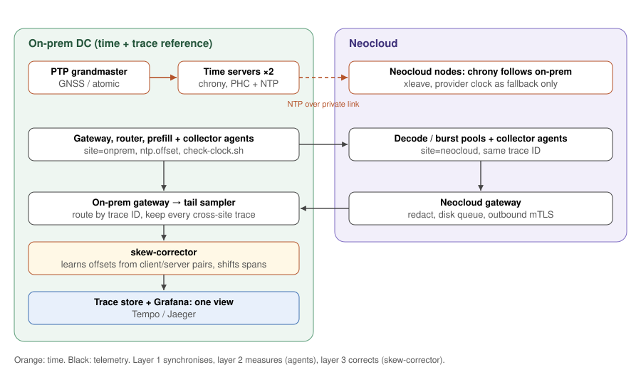

# Hybrid tracing

One trace view for LLM serving that runs across an on-prem data center and a neocloud. A request can be:
- routed on-prem,
- prefilled on an on-prem GPU,
- have its KV cache shipped over the private link,
- be decoded in the neocloud.

All of those spans land in one trace, on one timeline.

That timeline is only as good as the clocks that stamped it. Without a shared time reference, a decode span in the neocloud can appear to start before the prefill that fed it, and the KV transfer shows a negative or inflated duration. This folder handles clocks in three layers:

| Layer | What it does | Files |
| --- | --- | --- |
| **1. Synchronise** | PTP inside the on-prem site. Neocloud nodes follow the **on-prem time servers over the private link** instead of the provider's clock, so both sites share one reference. | `clock/*.chrony.conf`, `clock/ptp4l.conf`, `deploy/chrony-daemonset.yaml` |
| **2. Measure** | Every node reports its clock error. A check fails readiness when the error bound passes 1 ms; the collector agent records `ntp.offset` against the shared time servers. | `clock/check-clock.sh`, `collector/agent.yaml` |
| **3. Correct** | A pass-through in the trace pipeline estimates each machine's remaining offset from its own cross-machine calls and shifts its spans before they are stored. | `src/skew.mjs`, `src/service.mjs`, `tools/` |

The collector configs implement the rest of the design:
- site tags,
- prompt/completion redaction,
- a disk-backed queue for the WAN link,
- one tail-sampling decision per trace, which keeps every cross-site trace.



## Quick look

```bash
cd hybrid-tracing
npm run demo        # synthetic on-prem + neocloud traces with known clock offsets
```

```
3869 spans, 1600 two-way and 134 one-way cross-machine exchanges
Ordering violations: 531 before → 0 after (of 1734 cross-machine pairs)

machine       site      method      offset µs       ± µs  exchanges    true µs
batch-1       neocloud  none                –          –          0    -3000.0
decode-1      neocloud  two-way        2788.1      814.6        134     2700.0
decode-6      neocloud  two-way       12101.1      814.6        132    12000.0
stream-1      neocloud  bound          7624.8          –        134     7500.0
gw-1          onprem    reference         0.3       43.8       1200        0.0
prefill-1     onprem    two-way          -1.9       45.7        200       -2.0
…
```

On these traces, every machine with a cross-machine call has its offset recovered to within the WAN path's asymmetry (100 µs here), and every child span lands inside its parent again. `batch-1` makes no cross-machine calls, so it is reported as `none` and left as recorded. "± µs" is the guaranteed bound: half the fastest round trip. The true error is usually far smaller.

## Use it

**Correct exported traces** (OTLP/JSON, e.g. from the collector's `file` exporter):

```bash
node tools/fix-skew.mjs traces.jsonl -o fixed.jsonl          # report + corrected copy
node tools/fix-skew.mjs traces.jsonl --dry-run --json         # offsets only
```

**Correct live traces** between the tail-sampling tier and the trace store:

```bash
node tools/skew-corrector.mjs --port 4318 --downstream http://tempo:4318/v1/traces
```

- **Wiring:** point the tail sampler's `otlphttp` exporter at it with `encoding: json` (as in `collector/tailsampler.yaml`). Deploy with `Dockerfile` and `deploy/skew-corrector.yaml`.
- **Behaviour:** it learns offsets continuously, re-solves every 30 s, and forwards each batch as it arrives.
- **Endpoints:** `/offsets` shows the current table; `/metrics` exports `clock_skew_offset_seconds{domain,site}` and before/after violation counters.

**Synchronise the clocks:**
- Install `clock/onprem-timeserver.chrony.conf` on two or more on-prem time servers (following the PTP grandmaster through `ptp4l.conf`).
- Install `clock/onprem-node.chrony.conf` on on-prem nodes.
- Install `clock/neocloud-node.chrony.conf` on neocloud nodes.
- Where you can't change the neocloud node OS but can run privileged pods, use `deploy/chrony-daemonset.yaml`.

[docs/CLOCKS.md](docs/CLOCKS.md) explains the choices and the accuracy to expect.

**Collect:** run the OpenTelemetry Collector (contrib) with `collector/agent.yaml` on every node in both sites, then:
- `gateway-neocloud.yaml` in the neocloud,
- `gateway-onprem.yaml` and `tailsampler.yaml` on-prem.

Each file lists the environment variables it needs.

## How the correction works

- **Clock domains:** every span carries `host.name`; each host is one clock domain.
- **Two-way samples:** when a CLIENT span on host A has a SERVER child on host B, the four timestamps are an NTP exchange. They give B's offset from A and a bound on its error, half the round trip. For each pair of hosts, the lowest-delay exchanges are kept.
- **Solve:** pairwise offsets are combined in a weighted least-squares fit over all hosts, anchored so the reference site (default `onprem`) is zero.
- **One-way hops:** producer/consumer and other one-way hops only bound an offset. They place hosts that have no two-way exchange.
- **Measured offsets:** offsets from chrony (`--known offsets.json`) fill in hosts with no exchanges at all.
- **Output:** corrected spans carry `clock.skew_corrected_ns`, so the shift is visible in the trace UI.

**Known limit:** a constant asymmetry between the outbound and return network paths is invisible to any timestamp method, NTP included. The estimate is off by half that asymmetry, which is why layer 1 still matters.

## Tests

`npm test` covers:
- offset recovery, removal of ordering violations, one-way and isolated hosts, measured offsets, idempotence, and input formats;
- the live service: learning across batches, gzip, `/metrics`, rejection of protobuf, and downstream failures;
- the clock check's exit codes and metrics.

It also parses the chrony configs with `chronyd -p` and the PTP config with `ptp4l` when those are installed. CI additionally validates the collector configs with the official `otelcol-contrib` image.
