# Failure prediction and risk-aware scheduling

Design for taking gpu-health's risk ranking further: each GPU gets a calibrated probability of failing within the next few hours, critical jobs get only low-risk GPUs, and a test suite finds weak GPUs before they fail on real work.

Editable board: [GPU Failure Prediction & Risk-Aware Scheduling](https://claude.ai/artifact/EJ3a1712BQkfcQUFGsN9Dk)

The same diagram as Mermaid, for editing in the repo:

```mermaid
flowchart LR
  subgraph S1["1 · Signals"]
    dcgm["DCGM / AMD exporter"]
    xid["Xid / dmesg parser"]
    tests["Test-suite results"]
    outcomes["Job outcomes · RMAs<br/>(training labels)"]
  end
  subgraph S2["2 · Features per GPU serial"]
    rates["Rates and trend<br/>ECC · PCIe replay · NVLink CRC · Xids"]
    wear["Wear<br/>spare rows left · reset / RMA history"]
    peers["Peer z-scores<br/>temp · throttle · perf vs same SKU"]
  end
  subgraph S3["3 · Risk model"]
    rules["Day 1: rule-based hazard score"]
    surv["Later: survival model<br/>(LightGBM / Cox)"]
    cal["Calibrated P(fail within H hrs)"]
    shap["SHAP reasons per GPU"]
  end
  subgraph S4["4 · Risk tiers"]
    green["Green · p under 5%<br/>any job, incl. critical"]
    amber["Amber · 5–20%<br/>preemptible / checkpointed only"]
    red["Red · over 20% or hard signal<br/>cordon + diag"]
  end
  subgraph S5["5 · Scheduler gate"]
    jobrisk["Job risk = 1 − ∏(1 − pᵢ)"]
    budget["Critical budget under 2% over the run"]
    ckpt["Checkpoint every √(2 · C · MTBF)"]
    enforce["K8s DRA attribute / Slurm features"]
  end
  subgraph S6["6 · Test workloads (in spec, worst case)"]
    gemm["Deterministic GEMM hash → silent corruption"]
    soak["Full-node heat soak → temp drift vs peers"]
    pulse["Power-pulse bursts → Xids, power brake"]
    hbm["HBM patterns, hot → ECC delta, rows used"]
    nccl["NCCL + nvbandwidth → BW, CRC deltas"]
  end
  subgraph S7["7 · Agent layer (gpu-health skill)"]
    explain["Explain top-risk GPUs"]
    propose["Propose: re-tier · deep suite · reset · RMA"]
    approve["Execute only after approval"]
    rma["Bug report → RMA ticket"]
  end
  S1 --> S2 --> S3 --> S4 --> S5
  S6 -- "results become features" --> S1
  S4 -- "amber / red GPUs" --> S7
```

## What exists today and what this adds

| Piece | Today in gpu-health | This design adds |
|---|---|---|
| Signals | DCGM / AMD exporter scrapes, XIDs, ECC and row remaps, link errors, HBM temperature, throttling, power brake, telemetry gaps, SDC events, probes (`src/ingest.mjs`, `src/health.mjs`) | Test-suite results as first-class inputs (below); job outcomes and RMAs kept as training labels |
| Features | Peer comparison, own-history HBM rise, 3-of-4-window persistence (`src/health.mjs`) | Rates and acceleration over 1h / 24h / 7d windows, keyed by GPU serial |
| Model | Rules-first score, combined as 1 − ∏(1 − p), tiers low < 0.2 ≤ medium < 0.5 ≤ high (`src/risk.mjs`) | A survival model once labels accumulate, calibrated so 0.2 means 20%, with SHAP reasons |
| Gating | `suspect` and `quarantined` GPUs take no new jobs; high risk proposes `avoid-large-jobs`, `deep-diag-next-boundary`, `swap-at-checkpoint`, `drain-inference` (`src/actions.mjs`) | Green / amber / red tiers on calibrated probability, a job-level risk budget for critical work, risk-aware checkpoint intervals |
| Agent | gpu-health skill: explain, propose, approve only when told | Risk-triage workflow in the same skill |

The current interface stays: `rankRisk()` keeps returning `{ key, score, tier, why }`, so the model can be swapped without touching actions or reports.

## Risk model

1. **Rules (today).** `contributions()` in `src/risk.mjs`. Good for ranking. Its scores are not calibrated probabilities.
2. **Labels.** A failure is XID 48/64/79/94/95, a failed diag, a hardware-cause drain or an RMA within horizon H (start with 72h). Keep labels per GPU serial, not per slot, so a GPU moved to another node keeps its history.
3. **Survival model.** A discrete-time hazard model (gradient-boosted classifier on "fails within H") or a Cox objective, on the same features. Failures are rare, so weight the classes.
4. **Calibration.** Isotonic regression on a held-out month. Report Brier score, recall at a fixed precision, and median lead time. AUC alone flatters a rare-event model.
5. **Reasons.** SHAP top contributors replace the hand-written `why` strings.

## Tiers and the scheduler gate

| Tier | Starting rule | Gets |
|---|---|---|
| Green | p < 5% | Any job, including critical |
| Amber | 5–20% | Preemptible, checkpointed or low-priority work |
| Red | > 20%, or any hard signal | No new jobs; diag, then the repair ladder (auto-cordon; repairs need approval) |

- **Hysteresis:** enter amber at 15%, leave only after 24h below 8%, so GPUs don't flap.
- **Job-level risk.** A synchronous job fails if any of its GPUs fails: P(job) = 1 − ∏(1 − pᵢ) over its expected run time. Give critical jobs a budget (start at 2%) and place them on the GPU set that stays under it.
- **Checkpoint interval.** Young/Daly: interval ≈ √(2 × checkpoint cost × MTBF). Use the allocation's MTBF from the model, so riskier allocations checkpoint more often.
- **Enforcement.**
  - Kubernetes: per-GPU, use a DRA device attribute (`risk-tier`) and CEL selectors on critical jobs' claims. Node labels are per node, which is too coarse.
  - Slurm: node features plus a job-submit plugin; per-GPU control needs GRES changes or a node drain.
- **Approval.** Tier changes only steer placement and are reversible, so they apply automatically. Resets, reboots, drains and RMAs stay in the approval queue.

## Test workloads that find weak GPUs

Rule: worst case within spec, never overclocked. Snapshot counters before and after every test, and score each GPU against its peers, not only pass/fail.

| Subsystem | Workload | What gives a weak GPU away | Feeds |
|---|---|---|---|
| Compute / silent corruption | Deterministic GEMM in FP64, BF16 and FP8, fixed seeds and reduction order; hash outputs across identical GPUs and against a golden result | Any hash mismatch | `--results` with `kind: "sdc"`, `type: "replay-mismatch"` |
| Heat | Every GPU on the node at full power for 30–60 min, so neighbours heat each other | Temperature slope, steady-state temperature vs peers, throttling, clock droop | telemetry during the run |
| Power transients | Load switched on and off in bursts, like training's sync phases (DCGM's pulse test where available) | XIDs, power-brake events, falling off the bus | telemetry, `--results` |
| HBM | Memory pattern tests over all of HBM, run straight after the heat soak (errors depend on temperature) | Corrected-ECC delta, new spare rows used | ECC and remap counters |
| Interconnect | nccl-tests all-reduce / all-to-all, nvbandwidth for PCIe | Bandwidth vs peers, CRC and replay deltas, link downtraining | `--probes` (`linkGBs`), link counters |
| Performance fingerprint | Fixed microbenchmarks per GPU | Outlier within its SKU | `--probes` (`gemmTflops`, `hbmGBs`) |

**Cadence:**
- 2–5 minute canary in the prolog or epilog of critical jobs.
- 30-minute suite on a rotating ~5% of idle GPUs each night.
- Multi-hour deep run at intake, after an RMA return and after maintenance.

Reuse `dcgmi diag -r 3/4`, nccl-tests and nvbandwidth. The new code is the deterministic hash comparison and the peer scoring. GPUs the suite flags that later fail are the best training labels the model gets.

## Build order

1. **Tier gate on today's scores.** Map low / medium / high to green / amber / red, write a per-GPU risk-tier label, and add hysteresis.
2. **Job-level risk.** Compute P(job) for running and pending jobs, and add placement advice for critical jobs to the report.
3. **Test suite.** Ship the GEMM hash check and the soak → HBM sequence as a diag Job that writes `--probes` and `--results`.
4. **Learned, calibrated model.** After 3–6 months of labels, replace `contributions()` behind the same interface and switch the tiers to calibrated thresholds.
